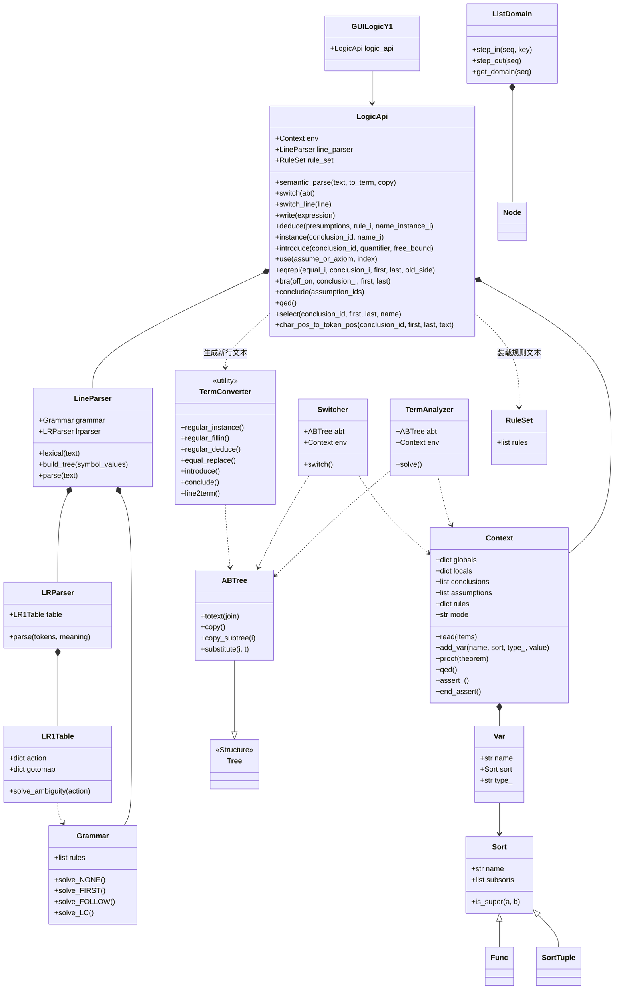
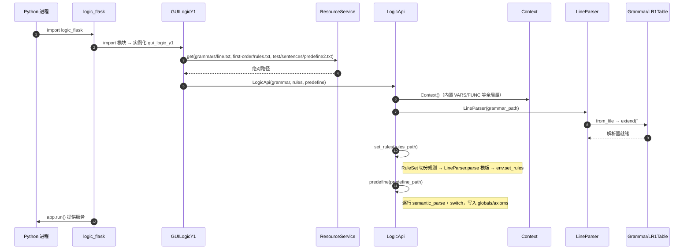
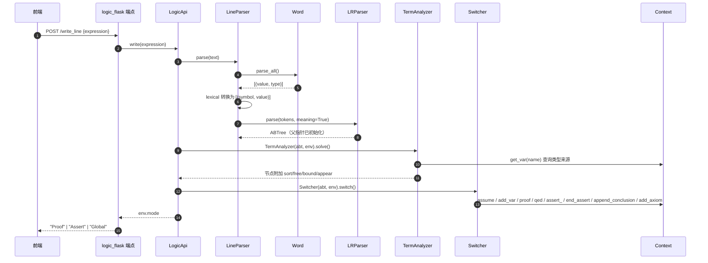
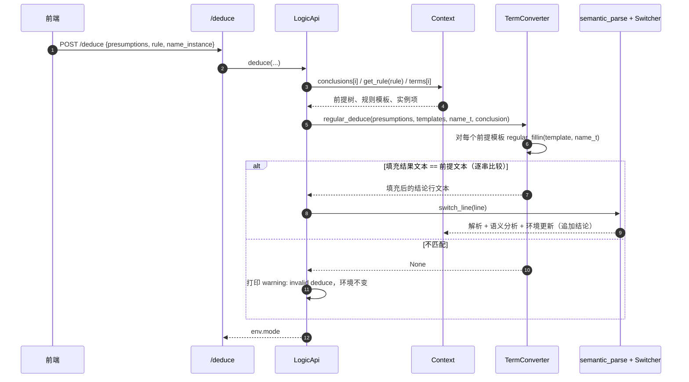

# 推理机Y 后端建模（backend_logic_y2_1）

> 建模对象：`backend_logic_y2_1` 的运行态后端（Python 3.10+，Flask）。
> 建模目的：提供快速理解与增量开发所需的精炼上下文。
> 参考：`dev/modeling/architecture_code_graph.md`、`AGENTS.md`。
> 记号约定：`文件:行号` 指向定义处；调用树节点后的 `[xxx]` 方法模式标签见 §3.6。

---

## 1. 上下文视图

### 1.1 相关背景

- **系统定位**：形式逻辑推理引擎后端，输入逻辑语句，维护“定义/假设/结论/定理”环境，支持量词、类型、等式替换与规则演绎；需求场景为数学定理证明辅助。
- **仓库位置**：`D:\WorkPlace\github\backend_logic_y2_1`，是后台当前分支。`backend_logic_y2` 为旧分支/演进基线，`cmd-logicy0` 为命令行前身，`forend-logicy2-1` 为 React 前端，`Structure` 为共享数据结构库。
- **运行形态**：Flask 服务 + 进程内命令行接口；无数据库、无持久化、无用户会话。推理状态只存在于进程内的 `Context` 单例中，重启即丢失。
- **装配时机**：`LogicApi` 在 `logic_y1.py` 模块导入期创建，文法解析表、推理规则、预定义环境均在导入期一次性装载；文法或规则变更需重启进程。
- **交互闭环**：前端/命令行提交操作 → 后端生成新行文本并重新解析、更新环境 → 前端调用 `/read` 拉取环境快照并重绘。返回的 `mode` 是唯一的操作结果信号。
- **当前演进方向**（`README.md`）：假设域栈（`semantic/domain.py` 已预留但未接入）、证明步骤记录、动态类型推断、异常健壮性。
- **协作约定**：发现问题先按 `dev/issues/template.md` 提 issue；回答与提交格式见 `AGENTS.md`。

### 1.2 参考文件

| 文件 | 作用 | 何时参考 |
|---|---|---|
| `AGENTS.md` | 仓库组成、issue 流程、回答/提交格式 | 每次协作开始 |
| `dev/modeling/architecture_code_graph.md` | 全栈架构与代码元素知识图 | 需要跨仓/分层视角时 |
| `dev/modeling/backend_logic_y2_1_modeling.md` | 本文件：后端建模 | 后端增量开发入口 |
| `interface/interface.yaml` | OpenAPI 3.0 契约：12 个端点与请求/响应字段 | 改接口或对接前端时 |
| `README.md` | 演进说明：假设域、证明记录、类型推断、健壮性 | 判断设计意图与预留接口时 |
| `resource/grammars/line.txt` | 顶层 CFG：`<line>/<term>/<set>/<type>` 等产生式 | 改语法或解析行为时 |
| `resource/first-order/rules.txt` | 推理规则文本 `{p1,p2} |- q` | 改演绎规则时 |
| `resource/test/sentences/predefine2.txt` | 预定义变量/函数/公理 | 改基准环境或复现用例时 |
| `dev/issues/`、`dev/request/` | 问题记录与开发请求 | 定位问题、追溯设计推演时 |
| `Structure/`（仓外） | `Tree/DiGraph/VTree/VDiGraph` 共享实现 | 改语法树基础行为时 |

**启动装载关系**

| 资源 | 启动消费者 | 内存表示 |
|---|---|---|
| `grammars/line.txt` | `LineParser` → `Grammar` → `LR1Table` | CFG 产生式、FIRST/FOLLOW、LR(1) action/goto 表 |
| `first-order/rules.txt` | `RuleSet` → `LineParser.parse` → `Context.rules` | `{rule_id: ([前提模板], 结论模板)}` |
| `test/sentences/predefine2.txt` | `LogicApi.predefine` → `semantic_parse` + `switch` | 预定义变量/函数/公理进入 `Context.globals/axioms` |

### 1.3 元素图谱

> 采用 `architecture_code_graph.md` 的符号系统：`+` 元素；缩进表示层级；`//` 说明职责/要点；`->` 表示调用、依赖或数据流。

```text
+ LogicY 后端上下文
    // 建模边界：运行态后端及其直接协作方；工程性目录不入图
    + 外部参与者
        + 浏览器前端 forend-logicy2-1
            // React SPA；按 interface.yaml 契约调用 REST 端点
        + 命令行前端 cmd-logicy0
            // Y0 交互；进程内调用同构 LogicApi，携带独立 Structure 副本
    + 外部依赖
        + Structure
            // Tree/DiGraph 与 VTree/VDiGraph；被 abtree/lrparser 依赖
    + 外部资源
        + resource/grammars/line.txt
        + resource/first-order/rules.txt
        + resource/test/sentences/predefine2.txt
            // 启动时由 ResourceService 定位；运行时不再变更
    + 协议契约
        + interface/interface.yaml
            // 12 个 POST 端点；推理操作统一返回 Proof/Assert/Global
    + 后端主体
        + 交互层
            + interface/logic_flask.py       // Flask app；端点 -> LogicApi
            + interface/logic_y1.py          // 资源装配；持有 LogicApi 单例
            + interface/logicY0.py           // 命令分派
            + interface/commander.py         // 命令行 -> (cmd,pos,key,remainder)
        + 业务层
            + semantic/logic_api.py          // 用例入口；转换 -> 重解析 -> 改环境
            + semantic/line.py               // LineParser/TermAnalyzer/Switcher
            + semantic/convert.py            // TermConverter；纯语法级变换
            + semantic/context.py            // Context/Var；环境状态与模式
            + semantic/sort.py               // Sort/Func/SortTuple；类型代数
            + semantic/ruler.py              // RuleSet；规则文本装载
            + semantic/domain.py             // ListDomain；域建模（预留，未接入）
        + 解析与数据结构层
            + grammar.py                     // CFG；FIRST/FOLLOW/LC
            + lrparser.py                    // LR(1) 项目集/分析表/移入-规约
            + words.py                       // 正则词法
            + abtree.py                      // ABTree；语法树 + 语义属性
        + 基础设施层
            + resource/resource_service.py   // 相对路径 -> 绝对路径
            + utils/                         // 集合方程、打印、序列化、索引换算
```

**上下文关联**

```text
浏览器前端   -> interface/logic_flask.py [REST] -> GUILogicY1.logic_api
命令行前端   -> CMDLogicY0.dispatch                  -> LogicApi
LogicApi     -> LineParser / TermConverter / Context / RuleSet
LineParser   -> Grammar / LR1Table / LRParser / Word / ABTree
LR1Table     -> utils.mathtools.SetEquation（FIRST/FOLLOW/闭包不动点）
ABTree       -> Structure.Tree
resource/*   -> ResourceService -> {LineParser 文法, RuleSet 规则, LogicApi.predefine}
LogicApi.env.mode -> 端点返回值 -> 前端
前端 /read   -> Context.read -> 环境快照 -> 前端重绘
```

**协议契约（端点 -> 用例）**

| 端点 | 请求要点 | LogicApi 操作 | 返回 |
|---|---|---|---|
| `/write_line` | `expression` | `write` | `mode` |
| `/deduce` | `presumptions, rule, name_instance` | `deduce` | `mode` |
| `/instance` | `conclusion_id, name_instance` | `instance` | `mode` |
| `/introduce` | `conclusion_id, quantifier, free_bound` | `introduce` | `mode` |
| `/select` | `conclusion_id, first, last, name` | `select` | `mode` |
| `/use` | `assume_or_axiom, index` | `use` | `mode`（JSON 字符串） |
| `/qed` | — | `qed` | `mode` |
| `/bra` | `off_on, conclusion_id, first, last` | `bra` | `mode` |
| `/conclude` | `assumption_ids` | `conclude` | `mode` |
| `/eqrepl` | `equal_id, conclusion_id, first, last, old_side` | `eqrepl` | `mode` |
| `/read` | `items`（`LN/TH/AX/TS/LC/GL/CC/AS/MD/TM/RL`） | `Context.read` | JSON 环境快照 |
| `/cp2tp` | `conclusion_id, first, last, text` | `char_pos_to_token_pos` | `[tfirst,tlast,cfirst,clast]` |

### 1.4 核心概念

| 概念 | 在本系统中的含义 | 物理载体 |
|---|---|---|
| 行 line / 项 term | `<line>` 是一条输入语句；`<term>` 是可推理的逻辑项（命题、集合、函数、量词式等） | `resource/grammars/line.txt`、`LineParser` |
| 语法树 ABTree | 移入-规约构造的有序树；叶子存 `symbol/value`，内部节点存 `production`，语义阶段再挂 `sort/free/bound/appear` | `abtree.py:3` |
| 语义属性 | `sort` 类型；`free` 自由变元及其出现位置；`bound` 约束变元到类型；`appear` 约束变元的出现位置 | `semantic/line.py:101` |
| 推理环境 Context | 全部推理状态的容器：行、全局/局部变量、结论、假设、公理、定理、规则、辅助项、模式 | `semantic/context.py:Context` |
| 模式 MODE | `Global`（全局定义）/ `Proof`（证明）/ `Assert`（断言公理）；决定裸项与变量落点 | `semantic/context.py:36`、`semantic/line.py:344` |
| 待证 / 定理 | 待证定理 `theorem` 进入 `Proof`；`qed` 匹配后归档到 `theorems` | `Context.proof/qed` |
| 假设 / 结论 | `Proof` 中 `assume` 追加假设；裸项追加局部结论；`conclude` 把假设归结为蕴涵式 | `Context.assumptions/conclusions` |
| 规则 / 模板 | `{前提,...} |- 结论`；装载时解析为 ABTree 模板，演绎时填充并做文本精确匹配 | `semantic/ruler.py:1`、`semantic/context.py:88` |
| 辅助项 term | 从结论中选取的子项，命名后存入 `Context.terms`，可作为实例代入 | `LogicApi.select`、`Context.add_term` |
| Sort 类型代数 | 复合类型 `A[B,C]`、函数类型、元组类型；`is_super` 做结构子类型判定 | `semantic/sort.py` |
| 转换范式 | 所有推理操作的统一范式：**生成新行文本 → 重新解析/语义分析 → 切换环境** | `LogicApi.switch_line` |
| 域 domain | 作用域/假设域，域间只允许包含或无交集；当前仅为预留模型 | `semantic/domain.py:ListDomain` |
| 字符位置 / token 位置 | 前端选区基于字符下标，后端选择子项基于叶子序号；`cp2tp` 负责换算 | `LogicApi.char_pos_to_token_pos` |

---

## 2. 静态视图

### 2.1 目录组织

```text
backend_logic_y2_1/
├─ interface/                 交互层：协议适配与装配
│  ├─ logic_flask.py          Flask app；12 端点 → LogicApi
│  ├─ logic_y1.py             GUILogicY1；装配资源路径并持有 LogicApi 单例
│  ├─ commander.py            Commander；命令行 → (cmd,pos,key,remainder)
│  └─ logicY0.py              CMDLogicY0；命令分派 → LogicApi
├─ semantic/                  业务层：用例、语义、环境、转换
│  ├─ logic_api.py            LogicApi；应用服务入口
│  ├─ line.py                 LineParser / TermAnalyzer / Switcher / LineAnalyzer
│  ├─ convert.py              TermConverter；纯语法级变换（无附加语义）
│  ├─ context.py              Context / Var；推理环境与模式
│  ├─ sort.py                 Sort / Func / SortTuple；类型代数
│  ├─ ruler.py                RuleSet；规则文本 {p1,p2} |- q 解析
│  └─ domain.py               ListDomain / Node；域建模（预留，未接入）
├─ grammar.py                 Grammar；CFG、FIRST/FOLLOW、正则文法 LC
├─ lrparser.py                LR1Item / LR1ItemSet / LR1Table / LRParser
├─ words.py                   Word；正则词法分析
├─ abtree.py                  ABTree；带语义属性的语法分析树
├─ utils/                     通用工具：集合方程、打印、序列化、索引换算
├─ resource/                  文法、规则、预定义、可视化产物
├─ test.py, test/             验证与运行入口（非运行态）
└─ dev/                       工程性文档（issues/request/modeling，非运行态）
```

**依赖方向**：`interface → semantic → {grammar, lrparser, abtree, words} → Structure/utils`。反向依赖仅出现在 `sys.path` 手工装配与局部 import 中，属于可改进点。

### 2.2 UML 类图



### 2.3 类职责与关键协作

| 类 | 定义 | 职责 | 关键协作 |
|---|---|---|---|
| `LogicApi` | `semantic/logic_api.py:12` | 应用服务：把用户操作翻译为“生成行文本 → 重解析 → 改环境” | `LineParser`、`TermConverter`、`Context` |
| `LineParser` | `semantic/line.py:16` | 文本 → token → ABTree；构造时求解文法并建 LR(1) 表 | `Word`、`Grammar`、`LR1Table`、`ABTree` |
| `TermAnalyzer` | `semantic/line.py:92` | 静态语义：变量名、类型、自由/约束变元、出现位置 | `ABTree` 节点属性、`Context.get_var` |
| `Switcher` | `semantic/line.py:344` | 按 `<line>` 子产生式分派环境变更 | `Context` 的 `assume/add_var/proof/qed/assert_/append_conclusion/add_axiom` |
| `TermConverter` | `semantic/convert.py:9` | 纯语法级变换：代入、填充、替换、括号、归结 | `ABTree.substitute/totext` |
| `Context` | `semantic/context.py:59` | 推理环境状态容器 + 三种模式 | `Var`、`ABTree` |
| `Var` | `semantic/context.py:40` | 变量语义：名 + Sort + 指代类型（`any/one/bound`）+ 值 | `Sort` |
| `Sort` | `semantic/sort.py:2` | 类型代数：复合类型、结构子类型判定 | `Func`、`SortTuple` |
| `Func` / `SortTuple` | `semantic/sort.py:113/125` | 函数类型 / 元组类型 | `Sort` |
| `RuleSet` | `semantic/ruler.py:1` | 规则文本 → `([前提串], 结论串)` | `LineParser.parse` |
| `ABTree` | `abtree.py:3` | 语法树：移入/规约/接受、子树复制、文本化、结构相等 | `Structure.Tree`、`VTree` |
| `Grammar` | `grammar.py:4` | CFG：产生式、NONE/FIRST/FOLLOW/LC 求解 | `SetEquation` |
| `LR1Item/ItemSet` | `lrparser.py:10/59` | LR(1) 项目、闭包、GOTO 项目集 | `Grammar`、`SetEquation` |
| `LR1Table` | `lrparser.py:172` | ACTION/GOTO 表；移入-规约冲突消解 | `Grammar` |
| `LRParser` | `lrparser.py:275` | 移入-规约解析，边解析边构造 ABTree | `LR1Table`、`ABTree` |
| `Word` | `words.py:14` | 正则词法扫描，输出 `(symbol, value)` | `re` |
| `GUILogicY1` | `interface/logic_y1.py:6` | 资源路径装配 + 全局单例 | `ResourceService`、`LogicApi` |
| `CMDLogicY0` | `interface/logicY0.py:5` | 命令解析与分派 | `Commander`、`LogicApi` |
| `ListDomain` | `semantic/domain.py:11` | 域栈 / 域区间树；**尚未接入 Context** | `Node` |
| `ResourceService` | `resource/resource_service.py:2` | 资源相对路径 → 绝对路径 | `os.path` |
| `SetEquation` | `utils/mathtools.py:3` | 单调集合方程不动点迭代 | 被文法与 LR 闭包复用 |

---

## 3. 动态视图

### 3.1 启动装配（导入期完成）



### 3.2 统一写链路：`switch_line` / `semantic_parse`（核心链路）

所有“生成新文本”的推理操作最终都汇入此链路。



`Switcher.switch` 的分派依据是 `<line>` 第一个子节点的产生式（`semantic/line.py:357-408`）：

| 产生式 | 环境动作 |
|---|---|
| `<assume> assume <term>` | 仅在 `Proof` 模式追加假设 |
| `<declare> any/one <varT_list>` | 按模式写入 `locals` 或 `globals` |
| `<assign> one <var> := <term>` | 写入变量（含值） |
| `<theorem>/<lemma>` | 进入 `Proof`，记录待证定理 |
| `<qed>` | 结论匹配则归档定理并清空局部状态 |
| `<assert>` / `<end>` | 进入 `Assert` / 退出 `Assert` |
| `<term>`（裸项） | `Proof` 追加结论；`Assert` 写公理；`Global` 忽略 |
| `<proof> proof` | 文法存在，但 Switcher 未处理（无环境动作） |

### 3.3 演绎 `deduce`（转换 → 重解析 → 改环境）



**要点**：演绎是基于**语法文本精确匹配**的模板演绎，不是合一（unification）。前提与填充模板只要空白/括号形式不同即判定失败。

### 3.4 其余转换类操作（同一范式）

| 操作 | 转换器 | 额外校验 | 汇入 |
|---|---|---|---|
| `instance` | `regular_instance` | 依赖语义阶段写入的 `appear` 位置 | `switch_line` |
| `introduce` | `introduce` | 自由变元改名 + 生成 `∀/∃` 文本 | `switch_line` |
| `eqrepl` | `select_by_pos` → `equal_replace` | 断言等式两侧为括号项、待替换子树结构相等 | `switch_line` |
| `bra on` | `on_bracket` | 无 | `switch_line` |
| `bra off` | `off_bracket` | 重解析后与预期树 `ABTree.equal` 比较 | 通过才 `switch_line` |
| `conclude` | `conclude_start` + `conclude` | 仅 `Proof` 模式；移除已用假设 | `switch_line` |
| `use` | 取 `assumptions/axioms/theorems[i].totext()` | 索引越界未捕获 | `switch_line` |
| `qed` | — | 结论文本与待证文本相等 | 直接改 `Context` |
| `select` | `select_by_pos` + `copy_subtree` | 子项写入 `Context.terms` | 不重解析 |

### 3.5 环境读取 `/read`

```text
POST /read {items}
  → Context.read(*items)                         [STATE]
       → 按码表选取数据：LN/TH/AX/TS/LC/GL/CC/AS/MD/TM/RL
       → list/dict 逐项 map：totext(" ") / var2dict / rule2str
  → jsonify(result)
```

说明：`/read` 是前端重绘的唯一数据来源，返回的是**字符串化快照**，不含节点 id/结构信息。

### 3.6 调用树（带方法模式标签）

| 标签 | 方法模式 | 标签 | 方法模式 |
|---|---|---|---|
| `[REST]` | HTTP 端点 | `[BOOT]` | 启动/装配 |
| `[IO]` | 文件读写 | `[APP]` | 应用服务/用例编排 |
| `[PARSE]` | 解析编排 | `[LEX]` | 词法扫描 |
| `[LR]` | LR(1) 移入-规约 | `[TABLE]` | 分析表构建/查表 |
| `[AST]` | 语法树操作/标注 | `[SEM]` | 静态语义分析 |
| `[SCOPE]` | 变元/作用域绑定 | `[TYPE]` | 类型解析/推断 |
| `[ENV]` | 产生式驱动的环境分派 | `[STATE]` | 环境状态读写 |
| `[PURE]` | 无环境副作用的文本/树转换 | `[ALGO]` | 集合方程/建表算法 |

#### 公共子树

**A. `semantic_parse`：文本 → 带语义的语法树**

```text
LogicApi.semantic_parse(text)                              [APP]
├─ LineParser.parse(text)                                  [PARSE]
│  ├─ LineParser.lexical(text)                             [LEX]
│  │  └─ Word.parse_all()
│  │     ├─ Word.look_one()  // 按词法正则取下一个词        [LEX]
│  │     └─ 翻转为 [(symbol, value)]                       [LEX]
│  └─ LineParser.build_tree(symbol_values)                 [PARSE]
│     ├─ LRParser.parse(tokens, meaning=True)              [LR]
│     │  ├─ LR1Table.action[(state, token)] 查表            [TABLE]
│     │  └─ ABTree.movein / reduce / accept  // 边解析边建树 [AST]
│     └─ ABTree.init_parents()                             [AST]
└─ TermAnalyzer(abt, env).solve()                          [SEM]
   ├─ solve_var_names()                                    [AST]
   ├─ solve_type()                                         [TYPE]
   ├─ solve_varT_list()                                    [AST]
   ├─ solve_var()   // 自顶向下继承 bound；自底向上收集 free [SCOPE]
   └─ sort_deduce() // 按产生式赋 sort；函数应用校验输入子类型 [TYPE]
```

**B. `switch`：产生式 → 环境状态变更**

```text
LogicApi.switch(abt)                                       [ENV]
└─ Switcher(abt, env).switch()
   ├─ abt.get_child(root, 1) -> production                 [AST]
   ├─ <assume>   -> Context.assume(term)                   [STATE]
   ├─ <declare>  -> Context.add_var(name, sort, type_)     [STATE]
   ├─ <assign>   -> Context.add_var(..., value)            [STATE]
   ├─ <theorem>/<lemma> -> Context.proof(theorem)           [STATE]
   ├─ <qed>      -> Context.qed()                          [STATE]
   ├─ <assert>   -> Context.assert_()                      [STATE]
   ├─ <end>      -> Context.end_assert()                   [STATE]
   └─ 裸 <term>  -> append_conclusion / add_axiom / 忽略    [STATE]
      // Proof -> 结论；Assert -> 公理（固定键 theorem_name）；Global -> 告警忽略
      // <proof> proof 已入文法，但此处未处理（无环境动作）
```

**C. `switch_line` = 公共子树 A + B**（所有“生成新文本”的推理操作共用）。

#### 各入口调用树

```text
[REST] POST /write_line
└─ LogicApi.write(expression)                             [APP]
   ├─ semantic_parse(expression)                           [APP] → 公共子树 A
   └─ switch(abt)                                          [ENV] → 公共子树 B
```

```text
[REST] POST /deduce
└─ LogicApi.deduce(presumptions, rule_i, name_instance_i) [APP]
   ├─ Context.conclusions[i] / get_rule(rule_i) / terms[i] [STATE]
   ├─ TermConverter.regular_deduce(...)                    [PURE]
   │  ├─ regular_fillin(template, name_t) × 前提数          [PURE]
   │  │  └─ regular_replace -> ABTree.substitute           [AST]
   │  └─ 逐串比较 abt.totext(" ") == filled_template       [PURE]
   │     // 文本精确匹配而非合一；不匹配返回 None，环境不变  [PURE]
   └─ switch_line(结论文本)  // 仅匹配成功时                [APP]
      └─ 公共子树 A + B
```

```text
[REST] POST /instance
└─ LogicApi.instance(conclusion_id, name_i)               [APP]
   ├─ Context.conclusions[id] / terms[i]                   [STATE]
   ├─ TermConverter.regular_instance(conclusion, name_t)   [PURE]
   │  ├─ root_data["appear"][name] 取约束变元出现位置       [SEM]
   │  ├─ regular_replace -> ABTree.substitute              [AST]
   │  └─ 返回去掉量词后的项文本                             [PURE]
   └─ switch_line(新文本)                                  [APP]
```

```text
[REST] POST /introduce
└─ LogicApi.introduce(conclusion_id, quantifier, free_bound) [APP]
   ├─ Context.get_var(free).sort × 自由变元数               [STATE]
   ├─ Var(bound, sort, "bound")                            [PURE]
   ├─ TermConverter.introduce(...)  // 自由变元改名 + 生成量词文本 [PURE]
   └─ switch_line(新文本)                                  [APP]
```

```text
[REST] POST /use
└─ LogicApi.use(assume_or_axiom, index)                   [APP]
   ├─ Context.assumptions / axioms / theorems[index]       [STATE]
   ├─ ABTree.totext(" ")                                   [AST]
   └─ switch_line(文本)                                    [APP]
```

```text
[REST] POST /eqrepl
└─ LogicApi.eqrepl(equal_i, conclusion_i, first, last, old_side) [APP]
   ├─ Context.conclusions[equal_i / conclusion_i]          [STATE]
   ├─ TermConverter.select_by_pos(conclusion, [first,last]) [AST]
   │  └─ ABTree.common_ancestors -> 最近公共 <term> 祖先    [AST]
   ├─ TermConverter.equal_replace(...)                     [PURE]
   │  ├─ assert 等式两侧均为括号项                          [PURE]
   │  ├─ assert ABTree.equal(等式旧侧, 待替换子树)          [AST]
   │  └─ ABTree.substitute(等式新侧子树)                   [AST]
   └─ switch_line(新文本)                                  [APP]
```

```text
[REST] POST /bra
└─ LogicApi.bra(off_on, conclusion_i, first, last)        [APP]
   ├─ select_by_pos -> 子项节点                            [AST]
   ├─ on  -> TermConverter.on_bracket -> 文本              [PURE]
   ├─ off -> TermConverter.off_bracket -> 文本 + 预期树    [PURE]
   │        └─ 重解析文本后 ABTree.equal(实际, 预期)        [AST]
   └─ switch_line(文本)  // off 仅在结构相等时执行          [APP]
```

```text
[REST] POST /conclude
└─ LogicApi.conclude(assumption_ids)                      [APP]
   ├─ Context.conclude_start(ids)  // 仅 Proof；取出并移除已用假设 [STATE]
   ├─ TermConverter.conclude(assumptions, conclusions[-1]) [PURE]
   └─ switch_line("( a1 ) ∧ ... -> ( c )")                 [APP]
```

```text
[REST] POST /qed
└─ LogicApi.qed()                                        [APP]
   └─ Context.qed()                                       [STATE]
      // 比较 theorem 与 conclusions[-1] 文本；匹配则归档定理并清空局部
```

```text
[REST] POST /select
└─ LogicApi.select(conclusion_id, first, last, name)      [APP]
   ├─ Context.conclusions[id]                             [STATE]
   ├─ TermConverter.select_by_pos -> 子项节点              [AST]
   ├─ ABTree.copy_subtree(i, basiccopy)                   [AST]
   └─ Context.add_term(name, subtree)                     [STATE]
```

```text
[REST] POST /read
└─ Context.read(items)                                   [STATE]
   ├─ 按码表取 LN/TH/AX/TS/LC/GL/CC/AS/MD/TM/RL          [STATE]
   ├─ ABTree.totext(" ") / Var -> dict                    [AST/PURE]
   └─ rule2str(rules)                                     [PURE]
```

```text
[REST] POST /cp2tp
└─ LogicApi.char_pos_to_token_pos(...)                    [APP]
   ├─ Context.conclusions[id].totext(" ").split(" ")      [AST]
   ├─ ListAlgorithms.map_sublist  // 去空白；建原/子下标映射 [PURE]
   ├─ ListAlgorithms.item_index_to_seg_index              [PURE]
   │  / seg_index_to_item_index                           [PURE]
   └─ TermConverter.select_by_pos -> ABTree.get_leaf_range [AST]
```

### 3.7 状态视图（推理模式）

```mermaid
stateDiagram-v2
    [*] --> Global
    Global --> Proof: theorem/lemma <term>（Context.proof）
    Proof --> Global: qed（结论匹配 → 归档定理、清空局部）
    Global --> Assert: assert（Context.assert_）
    Assert --> Global: ;（Context.end_assert）
    Proof --> Proof: assume / 裸结论 / declare / use / deduce / instance / introduce / eqrepl / bra / conclude
```



| 模式 | 裸项语义 | 变量落点 | 允许的关键操作 |
|---|---|---|---|
| `Global` | 忽略并告警 | `globals` | `one/any` 声明、`theorem/lemma`、`assert` |
| `Proof` | 追加到 `conclusions` | `locals` | assume、结论、全部推理操作、`qed` |
| `Assert` | 写入 `axioms` | `globals` | 声明、裸项断言、`;` 结束 |

**已知边界**：

- `qed` 依赖 `conclusions[-1]`，无结论时直接抛 `IndexError`。
- `Assert` 模式的裸项固定写入键 `"theorem_name"`（`semantic/line.py:405`），多次断言会互相覆盖。
- `proof` 关键字在文法中存在但无环境动作；进入证明实际依靠 `theorem/lemma`。

### 3.8 算法视图（解析与类型推断）

| 算法 | 位置 | 机制 | 复杂度/约束 |
|---|---|---|---|
| 集合方程不动点 | `utils/mathtools.py:3` | 单调迭代，直至集合不再增长 | 方程规模 × 迭代轮次 |
| NONE/FIRST/FOLLOW | `grammar.py:93-169` | 构造方程 → `SetEquation` | 产生式数量驱动 |
| LR(1) 项目集/闭包 | `lrparser.py:59-170` | 闭包内部用 `SetEquation` 传播 FOLLOW；BFS 求 GOTO | 状态数取决于文法 |
| 冲突消解 | `lrparser.py:212-247` | 移入 vs 规约：优先级列表；同优先级看结合性；>2 动作不支持 | 启发式，非通用消歧 |
| 移入-规约解析 | `lrparser.py:304-354` | 状态栈 + 符号栈，边解析边 `movein/reduce` 建树 | O(token 数) |
| 类型推断 | `semantic/line.py:254-343` | 按产生式模式自底向上赋 `sort`；函数应用断言输入子类型 | 不完整（未知变量暂定 `Set`） |
| 语法相等 | `abtree.py:126-146` | 逐节点比较 symbol/value 或 production | 用于等式替换/去括号校验 |

---

## 4. 关键设计约束与演进入口

| 约束/现状 | 影响 | 相关位置 |
|---|---|---|
| 推理状态为进程级单例 | 不支持多用户/多会话；测试需重置环境 | `interface/logic_y1.py:20` |
| 无持久化与证明步骤记录 | 重启丢失；README 中的“proof steps”仍未实现 | `semantic/context.py:59` |
| 域栈 `ListDomain` 未接入 | 假设域/作用域仍是扁平 `assumptions` 列表 | `semantic/domain.py:11`、`README.md` |
| 字符串相等即术语相等 | 演绎、等式替换对空白/括号敏感 | `semantic/convert.py:161-181` |
| 无输入校验/统一异常处理 | 非法请求与 `IndexError` 直接冒泡为 HTTP 500 | `interface/logic_flask.py:17-106` |
| 解析链在构造时完成建表 | 启动成本高；文法变更需重启 | `semantic/line.py:22-29` |

**按增量目标进入**：

- 加推理操作 → `semantic/logic_api.py` + `semantic/convert.py` + 端点/契约。
- 改文法/解析 → `resource/grammars/line.txt` + `grammar.py` + `lrparser.py`。
- 改语义/类型 → `semantic/line.py:TermAnalyzer` + `semantic/sort.py` + `Context.get_var`。
- 改状态机/作用域 → `semantic/context.py` + `semantic/domain.py` + `Switcher.switch`。
- 改接口/前端协作 → `interface/logic_flask.py` + `interface/interface.yaml`。
