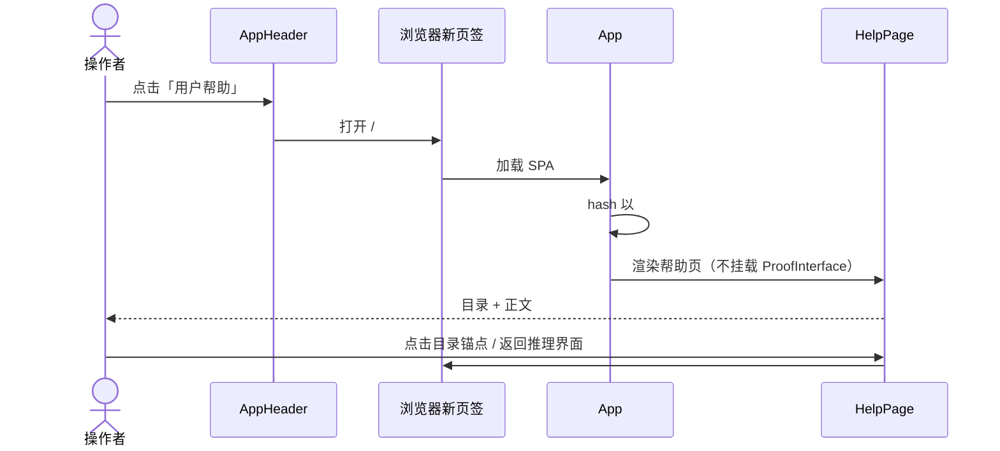
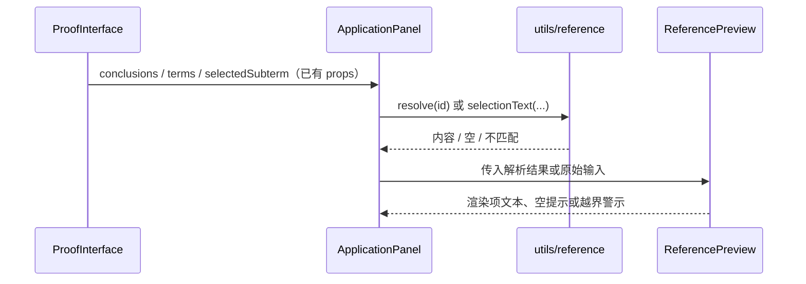

# 用户帮助与选区内容展示 增量建模

> 概念性文档：图中名称用于解释概念，不规定实际标识符；实际命名以仓库编码规则为准。
> 本文只描述增量及其影响；未变更部分以基线文档为准，不在此复述。

## 1. 基线与增量声明

- **基线建模**：`backend_logic_y2_1/dev/modeling/ui/forend_logic_y2_1_modeling.md`
- **基线点**：前台 `forend-logicy2-1@0c3e0b7`（2025-05-05）；基线文档所在后台仓 `backend_logic_y2_1@93177ae`（2026-10-17）
- **基线范围**：前台运行态 UI 模型 §1–§5；本增量涉及 B-§1.3、B-§1.4、B-§2.2、B-§3.1、B-§3.2、B-§3.3、B-§3.5、B-§4.1、B-§4.4、B-§4.5。
- **增量来源**：`dev/request/user_help.md`；设计依据 `dev/superpowers/specs/2026-10-17-user-help-and-selection-preview-design.md`
- **状态**：`[IMPLEMENTED]`（2026-10-17；单测 4 套 / 13 项通过；交互式浏览器验证未由 AI 执行）
- **不变边界**：后台推理机、`interface.yaml` 契约、规则语义与请求载荷、全量 `/read` 刷新、3 秒选区换算、无认证/无权限模型。

## 2. 上下文视图

### 2.1 相关背景

前台是推理机Y 的图形工作台，负责命令输入、结论选区、辅助项创建与规则应用；所有领域状态由后台持有，前台只持有 `/read` 快照并在每次变更后全量刷新（B-§1.1）。

当前没有面向用户的使用参考：命令、规则参数、面板操作只存在于开发文档中。同时，规则表单只显示结论 ID，替换/操作范围只显示起止 token，用户难以把数字与具体项对应；等式替换的「左侧/右侧替换」也没有解释。结论编号现已在界面、请求载荷与后台统一为 0 基。

本次增量面向原型形态做三件事：

1. 新增用户帮助页，从顶部栏在新页签打开，覆盖命令、规则、面板、完整示例与 FAQ。
2. 在结论 ID、辅助项、替换/操作范围处补充只读的项内容预览。
3. 为等式替换的左右侧语义增加 `?` 悬浮说明。

增量不改变推理流程与前后台契约，是在现有单页外壳上增加一个哈希入口与若干只读展示单元。

### 2.2 参考文件

| 文件 | 作用 | 何时读 |
|---|---|---|
| `dev/modeling/ui/forend_logic_y2_1_modeling.md` | 基线模型（B-§x 引用依据） | 理解未变更结构、组件与数据绑定 |
| `dev/request/user_help.md` | 增量需求原文 | 核对三项需求范围 |
| `dev/superpowers/specs/2026-10-17-user-help-and-selection-preview-design.md` | 本次增量的设计决策 | 核对入口、预览规则、tooltip 文案 |
| `dev/help/proof_add_add_zero_guide.md` | 帮助页「完整示例」的来源 | 核对 12 步 ADD 证明 |
| `D:\WorkPlace\github\AGENTS.md` | 工作区流程与回答/提交格式 | 进入项目、提交前 |
| `semantic/logic_api.py` | 结论 ID 的 0 基访问（`:112`） | 核对 ID 语义 |
| `semantic/convert.py` | `old_side` 的等值替换语义（`:99-125`） | 核对 tooltip 文案 |
| `forend-logicy2-1/context/interface.yaml` | 12 端点契约 | 确认本增量不改契约 |

### 2.3 元素图谱

```
+ 证明操作者（人）
    // 单一角色：输入命令、选区、应用规则；无权限模型
+ 前台 SPA（forend-logicy2-1）
    + 启动装配
      + src\App.js                         // ~ 移除 hello, world.；挂 AppHeader；按 #help 渲染 HelpPage
      + src\App.css                        // ~ 左对齐；移除未使用的 logo 样式
    + 页面容器
      + src\components\ProofInterface.jsx  // 不变；继续提供 envData / selectedSubterm
    + 外壳与帮助
      + src\components\AppHeader.jsx       // + 顶部栏：产品名 + 用户帮助链接
      + src\components\HelpPage.jsx        // + 侧边目录 + 正文；静态内容，不发请求
      + src\styles\help.css                // + 帮助页样式
    + 展示与交互
      + src\components\ApplicationPanel.jsx// ~ 接入预览与 HelpTip；修正 bra 选区条件
      + src\components\common\ReferencePreview.jsx // + 结论 / 辅助项 / 选区三种只读预览
      + src\components\common\HelpTip.jsx  // + 可 hover / focus 的 ? 提示
    + 工具
      + src\utils\reference.js             // + 0 基 ID 解析、辅助项查找、选区文本判定
    + 接口客户端
      + src\api.js                         // 不变
      + src\config.js                      // 不变
    + 样式
      + src\styles\interface.css           // ~ 顶部栏高度、预览框、tooltip
+ 后台推理机（外部进程）
    + Flask 控制器 / LogicApi / Context    // 不变；仍为领域状态唯一所有者
+ 契约
    + context\interface.yaml               // 不变；本增量不新增端点或字段

关联：
  App -> #help -> HelpPage                    // 新页签内的哈希入口
  App -> AppHeader -> /#help                  // 外壳入口
  ProofInterface -> ApplicationPanel          // 既有 props 流（B-§3.3）
  ApplicationPanel -> ReferencePreview        // 只读派生
  ReferencePreview -> utils\reference         // 解析与判定
  ApplicationPanel -> HelpTip                 // 静态说明
```

### 2.4 核心概念

| 概念 | 含义 | 物理载体 |
|---|---|---|
| 帮助页哈希入口 | 哈希以 `#help` 开头时只渲染帮助页；不挂载推理界面 | `src/App.js:8`、`:19` |
| 顶部栏 | 主界面外壳的窄栏，承载产品名与帮助入口 | `src/components/AppHeader.jsx`；`src/App.css:9` |
| 结论内容预览 | 由结论 ID 解析出的只读文本，不进入请求载荷 | `ReferencePreview.jsx:4` + `utils/reference.js:1` |
| 选区文本预览 | 最近一次 `/cp2tp` 结果对应的字符区间文本；与起止 token 一致时才展示 | `ReferencePreview.jsx:34`、`utils/reference.js:25` |
| 0 基结论 ID | 后端 `env.conclusions[id]` 的下标；界面步骤标号与接口参数使用同一编号 | `semantic/logic_api.py:112`；`ProofArea.jsx` 的 `stepId` |
| 替换侧语义 | `old_side` 决定等式的哪一端作为被替换项 | `semantic/convert.py:99-125` |
| 可访问 tooltip | `?` 触发，hover 或键盘聚焦显示说明 | `src/components/common/HelpTip.jsx`；`interface.css` 的 `.help-tip__content` |

## 3. 静态视图

### 3.1 增量登记

| 标记 | 元素 | 基线锚点 | 新状态锚点 |
|---|---|---|---|
| `[ADD]` | `AppHeader` | B-§3.2 组件树无此节点 | `src/components/AppHeader.jsx` |
| `[ADD]` | `HelpPage` | B-§4.5 单页单视图、无路由 | `src/components/HelpPage.jsx` |
| `[ADD]` | `HelpTip` | B-§3.2 无 tooltip 单元 | `src/components/common/HelpTip.jsx` |
| `[ADD]` | `ReferencePreview` | B-§3.3 表单只绑定 ID/起止位置 | `src/components/common/ReferencePreview.jsx` |
| `[ADD]` | `reference` 纯函数 | B-§3.3 无 ID→内容解析 | `src/utils/reference.js` |
| `[ADD]` | 帮助页样式 | B-§3.1 仅 `interface.css` | `src/styles/help.css` |
| `[MOD]` | `App` | B-§1.3、B-§3.2 仅 `DeductionProvider + ProofInterface` | `src/App.js` |
| `[MOD]` | `App.css` | B-§3.5 CRA 残留 | `src/App.css` |
| `[MOD]` | `ApplicationPanel` | B-§3.5 接收 `conclusions`/`terms` 未使用；B-§4.1 选区自动填充 | `src/components/ApplicationPanel.jsx` |
| `[MOD]` | `interface.css` | B-§3.1 三栏占满视口；无预览/tooltip 样式 | `src/styles/interface.css` |
| `[MOD]` | `App.test.js` | B-§3.5 默认测试断言 “learn react” | 重写为哈希路由测试（mock `ProofInterface`/`HelpPage`） |
| `[ADD]` | 单测 | B-§测试层无此覆盖 | `src/utils/reference.test.js`、`src/components/AppHeader.test.js`、`src/components/HelpPage.test.js` |

### 3.2 受影响结构

```
App [MOD]                                  // 哈希分支 + 顶部栏
├─ AppHeader [ADD]                         // 产品名 / 用户帮助链接
├─ DeductionProvider                       // 不变（仍无消费者）
│  └─ ProofInterface                       // 不变
│     └─ ApplicationPanel [MOD]            // 只加展示，不改提交载荷
│        ├─ ConclusionPreview [ADD]        // 顶部结论 ID / 等式 ID
│        ├─ TermPreview [ADD]              // 量词消去辅助项
│        ├─ RangePreview [ADD]             // 替换范围 / 操作范围
│        └─ HelpTip [ADD]                  // 替换位置 ? 说明
└─ HelpPage [ADD]                          // hash 为 #help 时替代主界面
   ├─ 侧边目录（锚点 #help-*）
   └─ 静态章节
```

受影响单元均为函数组件或纯函数，无类层次变化，故不另画类图。

### 3.3 新单元职责

| 单元 | 职责 | 依赖 | 锚点 |
|---|---|---|---|
| `AppHeader` | 渲染顶部栏与帮助链接 | 无状态、无请求 | `src/components/AppHeader.jsx` |
| `HelpPage` | 渲染目录与用户帮助正文 | `help.css`；无 API | `src/components/HelpPage.jsx:279`；章节 ID `:6`、`:39`、`:90`、`:145`、`:177`、`:240` |
| `HelpTip` | hover / focus 显示说明 | React `useId` | `src/components/common/HelpTip.jsx:4` |
| `ReferencePreview` | 把解析结果渲染为只读预览或空/警示状态 | `utils/reference` | `src/components/common/ReferencePreview.jsx:4`、`:19`、`:34` |
| `utils/reference` | 结论 ID（0 基）、辅助项、选区文本的纯解析 | 无 | `src/utils/reference.js:1`、`:14`、`:25` |

## 4. 动态视图

### 4.1 受影响流程一：打开帮助页

主界面点击帮助链接后由浏览器新开页签；新页签加载 SPA，`App` 检测哈希并只渲染帮助页，因此不会触发 `/read`。



帮助页目录锚点统一使用 `#help-<section>`，使 `App` 的哈希判定在页内跳转时仍成立。

### 4.2 受影响流程二：预览派生

预览只读取已有 props 与选区状态，不产生新请求；规则提交路径保持 B-§3.3-B 不变。



### 4.3 调用树增量

```
App [BOOT]
├─ AppHeader [VIEW]                          // + added
│  └─ <a href="/#help">                      // + added
├─ ProofInterface [APP]                      // 基线 B-§3.2
│  └─ ApplicationPanel [VIEW]                // ~ changed
│     ├─ ConclusionPreview [PURE]            // + added
│     │  └─ reference.resolveConclusion      // + added [PURE]
│     ├─ TermPreview [PURE]                  // + added
│     │  └─ reference.resolveTerm            // + added [PURE]
│     ├─ RangePreview [PURE]                 // + added
│     │  └─ reference.resolveSelection       // + added [PURE]
│     └─ HelpTip [VIEW]                      // + added
└─ HelpPage [VIEW]                           // + added；hash #help 时渲染
   └─ 静态章节 / 目录锚点                     // [PURE]
```

变更分支说明：`ApplicationPanel` 的选区副作用条件由 `selectedSubterm && eqrepl || bra` 收紧为 `selectedSubterm && (eqrepl || bra)`；其余提交分支不变。

## 5. 影响与不变量

**影响边界**

- 直接邻居：`App` 外壳、`ApplicationPanel`、`interface.css`、CRA 默认测试。
- 数据来源：`ProofInterface` 的 `conclusions` / `terms` / `selectedSubterm` props（B-§3.3）已存在，无需改父组件。
- 契约：`context/interface.yaml` 与本增量无关；端点、字段、返回形态均不变。
- 测试：新增 `reference`、`AppHeader`、`HelpPage` 单测；`App.test.js` 由 CRA 默认断言重写为哈希路由断言。验证结果：4 套 / 13 项通过。
- 未验证项：未执行交互式浏览器验证（帮助链接新页签、预览渲染、tooltip 悬浮、完整证明流程）；需由用户在实际界面确认。

**必须保持的不变量**

- 结论 ID 仍为 0 基；界面步骤标号、拖动/选区 ID 与请求载荷使用同一 0 基编号。
- 规则载荷与 `handleApply` 的提交路径不变；预览不得影响表单值。
- 每次变更后仍全量 `/read`；无局部状态合并。
- 选区 `/cp2tp` 仍为 3 秒延迟；本次不改变其行为。
- 帮助页不发起任何后端请求；未知哈希回主界面。
- 不新增运行时依赖。

## 6. 基线回写与勘误

增量已落地（`[IMPLEMENTED]`），但基线回写暂缓：用户明确担心后续仍有变更，待增量稳定后再合并回基线文档。下表为回写计划，不是已执行操作。

| 基线位置 | 回写内容 |
|---|---|
| B-§1.3 元素图谱 | 增加 `AppHeader`、`HelpPage`、`HelpTip`、`ReferencePreview`、`utils/reference`、`help.css`；`App` 描述增加哈希分支 |
| B-§1.4 核心概念 | 增加帮助页哈希入口、只读预览、tooltip；「无路由」改为「无常规路由，仅有 `#help` 帮助入口」 |
| B-§2.2 任务 | 增加「查看用户帮助」任务 |
| B-§3.1 布局 | 增加顶部栏；主界面高度改为扣除栏高 |
| B-§3.2 组件树 | 增加顶部栏、帮助页与三种预览单元 |
| B-§3.3 数据绑定 | 增加「快照 → props → 只读预览」说明；明确预览不参与载荷 |
| B-§3.5 未接线/预留 | 删除 `conclusions`/`terms` 未使用项；删除 `hello, world.` 与默认测试项 |
| B-§4.1 事件 | 增加帮助入口事件 |
| B-§4.4 异常流 | 增加越界/无效 ID、手动范围、未知哈希的展示行为 |
| B-§4.5 导航 | 增加新页签帮助页与页内锚点 |

**基线勘误**：本次未发现基线事实错误；B-§3.5 的未使用项属于增量后状态变化，不是原基线错误。

## 7. 待确认问题

- 顶部栏产品名已实现为「逻辑推理机 Y」；如需与仓库/界面其他名称统一，仍可调整。
- 帮助页目录锚点已采用 `#help-<section>` 约定，以保证页内跳转不会离开帮助页。
- 帮助页内容与 `dev/help/proof_add_add_zero_guide.md` 的示例存在一份重复，属跨仓维护成本；当前接受，不引入 Markdown 运行时。
- 帮助页正文的静态内容不在单测覆盖范围内，仅验证章节标题、目录锚点与返回链接。
