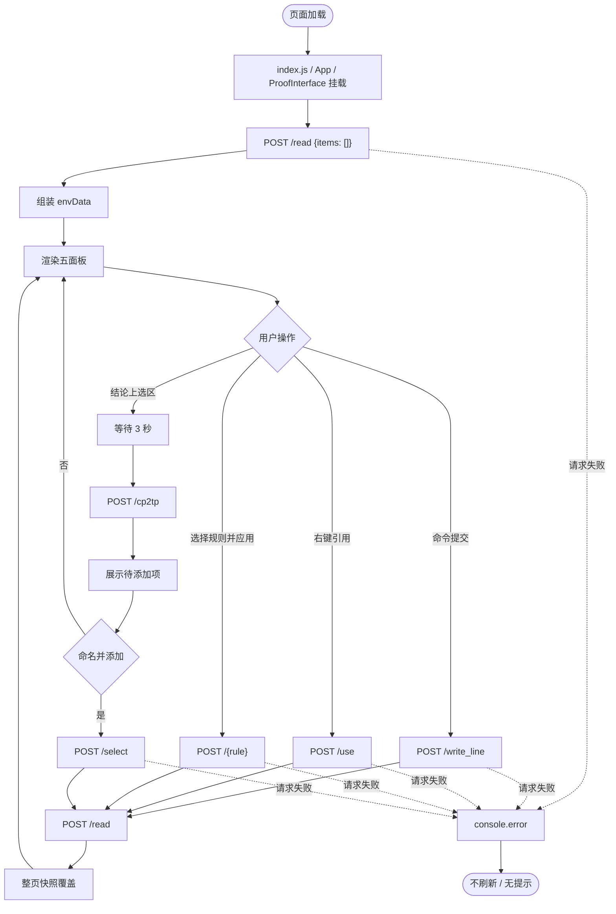
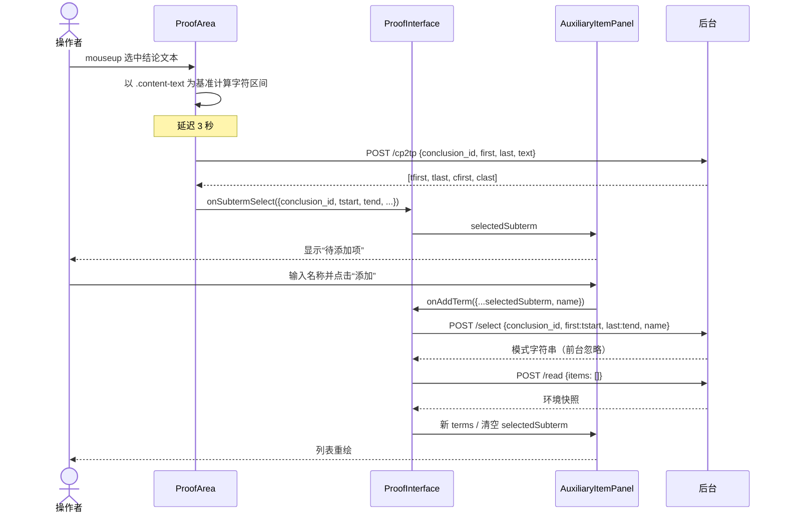

# 推理机Y 前台建模（forend-logicy2-1）

> 概念性文档：图中名称用于解释概念，不规定实际标识符；实际命名以仓库编码规则为准。
> 对象：`forend-logicy2-1`（React 单页应用，运行态）。意图：理解与增量开发。范围：前端运行时及其与后台的契约，不含后台内部实现。
> 假设：前台仓无 `AGENTS.md`，沿用工作区 `D:\WorkPlace\github\AGENTS.md`。

## 1. 上下文视图

### 1.1 相关背景

前台是推理机Y 的图形工作台。用户在此提交命令、选择局部结论、应用推理规则；文本解析、类型推断与环境变更全部由后台完成。前台不保存领域状态，只保存一次环境快照（`envData`），并在每次变更操作后重新读取（`src/components/ProofInterface.jsx:31-69`、`:98-106`）。

- **演进**：命令行 Y0（`cmd-logicy0`）→ Flask 图形后端（`interface/logic_y1.py`）→ 本 React 单页（`src/App.js:6-17`）。`context/ui-design.md` 给出两套辅助项方案，当前实现为方案2：结论上选区停留 3 秒后换算位置，右侧“待添加项”命名确认后入库（`context/ui-design.md:37-42`；`src/components/ProofArea.jsx:62-85`；`src/components/AuxiliaryItemPanel.jsx:11-33`）。
- **运行形态**：CRA 开发服务器加载单页（`package.json` scripts）；后端地址固定为 `http://127.0.0.1:5000`（`src/config.js:1`），Flask 开放 CORS（`context/logic_flask.py:9`），因此无代理、无登录、无路由。
- **前后台边界**：12 个 POST 端点由 `context/interface.yaml` 定义。变更类端点返回模式字符串，但前台忽略返回值，统一以 `/read` 的全量快照为准（`src/components/ProofInterface.jsx:98-119`）。
- **当前方向**：后台演进假设域/作用域，不改变前台契约；前台仍是原型形态（CRA 残留、预留状态容器未接线，见 §3.5）。

### 1.2 参考文件

| 文件 | 作用 | 何时读 |
|---|---|---|
| `D:\WorkPlace\github\AGENTS.md` | 工作区仓库组成、开发流程、回答/提交格式 | 进入项目、提交前 |
| `D:\WorkPlace\github\backend_logic_y2_1\dev\modeling\architecture_code_graph.md` | 全栈元素图谱与前后台闭环 | 定位前台在全系统中的位置 |
| `D:\WorkPlace\github\backend_logic_y2_1\dev\modeling\backend_logic_y2_1_modeling.md` | 后台契约、模式状态机、端点语义（§1.4、§3.7） | 需要理解端点真正做什么时 |
| `forend-logicy2-1\context\interface.yaml` | OpenAPI 3.0：12 端点请求/响应契约 | 改请求参数、排查契约偏差 |
| `forend-logicy2-1\context\ui-design.md` | 界面静态设计与动态场景；辅助项方案1/方案2 | 理解交互意图与设计取舍 |
| `forend-logicy2-1\context\data.json` | `/read` 返回样例（LN/TH/AX/TS/LC/GL/CC/AS/MD/TM/RL） | 核对快照字段结构 |
| `forend-logicy2-1\context\logic_flask.py` | 后台副本：端点实现、`/cp2tp` 数组返回、CORS | 核对响应形态 |
| `forend-logicy2-1\package.json` | React 19 + react-scripts 5、启动/构建/测试脚本 | 运行与构建 |
| `forend-logicy2-1\src\` | 当前实现；本文所有组件锚点的最终依据 | 增量开发 |

### 1.3 元素图谱

```
+ 证明操作者（人）
    // 单一用户角色：输入命令、选区、应用规则
+ 前台 SPA（forend-logicy2-1）
    + 启动装配
      + src\index.js                          // ReactDOM.createRoot + StrictMode
      + src\App.js                            // App 壳：DeductionProvider + ProofInterface
    + 页面容器（唯一视图）
      + src\components\ProofInterface.jsx     // envData 单一状态源；/read 装配；操作回调
    + 展示与交互组件
      + src\components\ProofArea.jsx          // 状态栏 + 证明步 + 命令输入 + 文本选区
      + src\components\ApplicationPanel.jsx   // 规则选择、动态参数、规则提交
      + src\components\TheoremAxiomPanel.jsx  // 定理/公理搜索 + 右键应用
      + src\components\VariablePanel.jsx      // 全局/局部变量表；拖拽源
      + src\components\AssumptionPanel.jsx    // 假设列表；右键应用
      + src\components\AuxiliaryItemPanel.jsx // 待添加项 + 辅助项卡片；拖拽源
    + 状态容器（预留）
      + src\contexts\DeductionContext.jsx     // Provider 已挂载，无消费者（未接线）
    + 接口客户端
      + src\api.js                            // axios 实例（JSON 头）
      + src\config.js                         // API_BASE_URL = 127.0.0.1:5000
    + 样式
      + src\styles\interface.css              // 三栏网格、面板、证明步、拖放反馈
+ 后台推理机（外部进程）
    + Flask 控制器                            // 12 个 POST 端点（contract 载体）
    + LogicApi / Context                      // 领域状态的唯一所有者
+ 契约
    + context\interface.yaml                  // 请求/响应 schema

关联：
  ProofInterface -> apiClient -> Flask -> LogicApi/Context
  ProofArea / ApplicationPanel / 四个侧栏面板 -> ProofInterface 回调 -> apiClient
  Flask -> /read 快照 -> ProofInterface -> props -> 各面板
```

### 1.4 核心概念

| 概念 | 含义 | 物理载体 |
|---|---|---|
| 环境快照 | 后端 `/read` 返回的完整 JSON；前端唯一数据来源 | `ProofInterface.jsx:14-26`、`:35-65` |
| 推理模式 | `Proof` / `Assert` / `Global`；后端持有，前台只读显示 | `ProofInterface.jsx:61-64`；`ProofArea.jsx:91-97` |
| 待证命题 | `/read` 的 `TH`，证明状态栏展示 | 同上 |
| 证明步 | `LN` 命令行 + `CC` 局部结论拼接成的有序列表 | `ProofInterface.jsx:161-164` |
| 局部结论 | `CC` 中的项；可被选区、拖拽为规则输入 | `ProofArea.jsx:31-34`、`:109-116` |
| 辅助项 | 从局部结论子项创建并命名的项（`TM`），可拖入规则表单 | `AuxiliaryItemPanel.jsx:11-51` |
| 规则应用 | 选一条规则后渲染对应表单，并以规则名作为端点名提交 | `ApplicationPanel.jsx:51-58`、`:348` |
| 拖放标识 | 通过 `dataTransfer` 在面板间传递的 MIME 键，见 §3.4 | 各组件 `onDragStart`/`onDrop` |
| 字符位置 / token 位置 | 浏览器选区是字符偏移；推理操作需要 token 偏移；`/cp2tp` 负责换算 | `ProofArea.jsx:62-81` |
| 全量刷新 | 每个变更操作后都重新 `/read`，不做局部状态合并 | `ProofInterface.jsx:98-119`、`:123-136` |
| 无权限 / 无路由 | 无登录、会话、角色与页面切换；仅表单可用性门控 | `App.js:6-17`；`ApplicationPanel.jsx:391-396` |

## 2. 用户视图

### 2.1 参与者与目标

- **参与者**：证明操作者。无管理员、无多用户、无匿名/登录区分。
- **目标**：在图形界面中完成一次形式证明——查看环境、输入命令、引用已知结论、对局部结论施加推理规则、在证明结束后提交 `qed`。
- **知识前提**：理解项语法与推理规则（命令与结论均为文本表达式，前台不做语法校验）。

### 2.2 任务

| 任务 | 入口 | 结果 |
|---|---|---|
| 查看当前环境 | 页面加载/每次操作后 | 五面板由 `/read` 快照重绘 |
| 输入证明命令 | `ProofArea` 底部命令框（`ProofArea.jsx:132-140`） | 写入命令并刷新 |
| 引用定理/公理/假设 | 右键条目（`TheoremAxiomPanel.jsx:20-26`；`AssumptionPanel.jsx:9-15`） | 引入为局部结论并刷新 |
| 应用推理规则 | `ApplicationPanel` 规则下拉 + 应用按钮（`:361-397`） | 生成新结论并刷新 |
| 从结论创建辅助项 | 结论文本选区 → 待添加项 → 命名添加（`ProofArea.jsx:31-86`；`AuxiliaryItemPanel.jsx:11-33`） | 新辅助项进入辅助项区 |
| 结束证明 | 规则下拉选 `qed` → 应用（`ApplicationPanel.jsx:290-295`、`:338-340`） | 后端校验并推进模式 |

各任务对应的请求与载荷见 §3.3。

### 2.3 权限

**无权限模型**：无认证、无会话、无角色；后台 CORS 对所有来源开放（`context/logic_flask.py:9`）。唯一约束是前端表单门控：未选规则，或（非 `qed` 时）未提供结论 ID，应用按钮禁用（`ApplicationPanel.jsx:391-396`）。

### 2.4 关键场景

- **S1 首次进入**：挂载即 `/read`，渲染空/已有环境（`ProofInterface.jsx:71-74`）。
- **S2 命令驱动证明**：命令框提交 → `/write_line` → 全量刷新（`:98-106`）。
- **S3 选区建辅助项**：结论上停 3 秒 → `/cp2tp` → 待添加项 → `/select`（§4.3 时序）。
- **S4 规则应用**：`eqrepl`/`bra` 会由最近一次选区自动填充结论 ID 与起止位置（`ApplicationPanel.jsx:36-48`）。
- **S5 引用已知结论**：右键定理/公理/假设即触发，无二次确认（§3.3）。
- **S6 结束证明**：选 `qed` 后可直接应用，不需要结论 ID（`ApplicationPanel.jsx:338-340`、`:391-396`）。

## 3. 结构视图

### 3.1 布局

三栏网格，左右各 300px，中间自适应；页面高度占满视口（`src/styles/interface.css:11-17`）。中央区上为证明区、下为规则应用区（`:19-23`）。

```
┌──────────────┬────────────────────────────┬──────────────┐
│ 定理/公理搜索 │  证明状态栏（模式 / 待证命题） │   假设列表    │
│ 定理/公理列表 │  证明步列表（命令 / 结论）     │              │
├──────────────┤  ──────────────────────────  ├──────────────┤
│ 变量表        │  命令输入框                   │   辅助项      │
│ 全局 / 局部   ├────────────────────────────┤  待添加项     │
│              │  推理规则选择 + 动态参数       │  辅助项卡片   │
│              │  [应用推理规则]                │              │
└──────────────┴────────────────────────────┴──────────────┘
```

面板高度固定为视口一半并各自滚动（`interface.css:26-33`）；证明步区限高并可滚（`:64-69`）。

### 3.2 组件树与复用

```
App
└─ DeductionProvider                      // 挂载但无消费者
   └─ ProofInterface                      // 页面容器；envData / selectedSubterm
      ├─ 左栏
      │  ├─ TheoremAxiomPanel             // 搜索 + 右键应用
      │  └─ VariablePanel                 // 全局/局部变量表（拖拽源）
      ├─ 中央
      │  ├─ ProofArea                     // 状态栏 + 证明步 + 命令框 + 选区
      │  └─ ApplicationPanel              // 规则下拉 + 动态参数 + 应用
      └─ 右栏
         ├─ AssumptionPanel               // 假设列表（右键应用）
         └─ AuxiliaryItemPanel            // 待添加项 + 辅助项卡片（拖拽源）
```

- 复用：`ApplicationPanel` 内的 `DraggableConclusionInput`（`:8-22`）封装“可拖放结论 ID 输入”，`eqrepl` 使用它；主结论 ID 输入（`:376-387`）重复了同一拖放行为。
- 重复：起止位置输入在 `eqrepl`（`:149-166`）与 `bra`（`:197-214`）各写一次；变量表全局/局部两段结构相同（`VariablePanel.jsx:19-33`、`:50-64`）。
- 组件均无独立数据获取：只接收 props、触发回调。

### 3.3 数据绑定

**A. 快照 → 状态 → 渲染**

| `/read` 字段 | `envData` 字段 | 渲染位置 |
|---|---|---|
| `LN` | `inputLines` | 证明步中的 command 步（`ProofInterface.jsx:58`、`:161-164`） |
| `CC` | `conclusions` | 证明步中的 conclusion 步（`:59`、`:163`） |
| `LC` / `GL` | `variables.local` / `.global` | `VariablePanel`（`:37-38`、`:150-153`） |
| `TS` / `AX` | `theorems`（附 `type`） | `TheoremAxiomPanel`（`:42-51`、`:143-148`） |
| `AS` | `assumptions` | `AssumptionPanel`（`:53`、`:181-184`） |
| `TM` | `terms` | `AuxiliaryItemPanel`（`:54-57`、`:185-190`） |
| `RL` | `rules` | `ApplicationPanel` 的规则列表（`:60`、`:173`） |
| `MD` / `TH` | `proofStatus.mode` / `.targetTheorem` | `ProofArea` 状态栏（`:61-64`、`:165`） |

**B. 动作 → 请求 → 刷新**

| 动作 | 处理函数 | 请求 | 后续 |
|---|---|---|---|
| 命令提交 | `handleCommandSubmit`（`ProofInterface.jsx:98-106`） | `POST /write_line {expression}` | 全量刷新 |
| 右键定理/公理 | `handleApplyItem`（`:109-119`） | `POST /use {assume_or_axiom:'theorem'\|'axiom', index:name}` | 全量刷新 |
| 右键假设 | `handleApplyItem` | `POST /use {assume_or_axiom:'assume', index:i}` | 全量刷新 |
| 结论文本选区 | `handleTextSelection`（`ProofArea.jsx:31-86`） | `POST /cp2tp {conclusion_id, first, last, text}` | 写入 `selectedSubterm`，不刷新 |
| 添加辅助项 | `handleAddTerm`（`ProofInterface.jsx:123-136`） | `POST /select {conclusion_id, first:tstart, last:tend, name}` | 刷新并清空选区 |
| 应用规则 | `handleApply`（`ApplicationPanel.jsx:302-359`） | `POST /{selectedRule}`，载荷见下 | `onDataRefresh` |

规则载荷（`ApplicationPanel.jsx:305-346`）：

| 规则 | 载荷 |
|---|---|
| `deduce` | `{presumptions:[结论ID], rule, name_instance}` |
| `instance` | `{conclusion_id: parseInt(结论ID), name_instance:{约束变元:辅助项名}}` |
| `eqrepl` | `{conclusion_id, equal_id, old_side, first, last}` |
| `bra` | `{conclusion_id, off_on, first, last}` |
| `qed` | `{}` |
| `introduce` | 走默认分支：`{quantifier, free_bound, presumptions:[结论ID]}`（缺 `conclusion_id`，见 §3.5） |

**C. 派生数据**：`proofSteps` 由 `inputLines` 与 `conclusions` 拼接，命令步在前、结论步在后（`ProofInterface.jsx:161-164`），并非后端返回的原始交错顺序。

### 3.4 拖放契约

| MIME 键 | 产生方 | 消费方 | 语义 |
|---|---|---|---|
| `conclusion/id` | 证明步拖动手柄（`ProofArea.jsx:112-115`） | 结论 ID 输入（`ApplicationPanel.jsx:16-19`、`:381-386`） | 局部结论下标（字符串） |
| `conclusion/content` | 同上（`:114`） | 读取后未使用（`:383`） | 结论文本（冗余） |
| `term/id` | 辅助项卡片（`AuxiliaryItemPanel.jsx:41`） | `instance` 拖放区（`ApplicationPanel.jsx:107-110`） | 辅助项名称 |
| `term/content` | 同上（`:42`） | 无 | 辅助项内容（未使用） |
| `variable/name` | 变量行（`VariablePanel.jsx:24-26`、`:55-57`） | 变量映射输入/拖放区（`ApplicationPanel.jsx:249-254`、`:272-280`） | 自由变量名 |
| `variable/type` | 同上（`:26`、`:57`） | 无 | 变量指代类型（未使用） |

拖放在浏览器内完成，不经过 React 状态库；落点组件自行解析 MIME 键并写本地状态。结论 ID 在 `instance` 提交时被 `parseInt` 转为整数（`ApplicationPanel.jsx:308`）。

### 3.5 未接线 / 预留

- `DeductionContext` 已挂载（`App.js:12-14`），但无组件调用 `useDeduction`；页面状态实际由 `ProofInterface` 本地持有（`DeductionContext.jsx:9-26`）。
- `ProofInterface` 声明 `selectedRule` 但未使用（`ProofInterface.jsx:27`）。
- `ProofArea` 接收 `assumptions` 但未渲染（`ProofArea.jsx:4-6`）；`ApplicationPanel` 接收 `conclusions`、`terms` 但未使用（`ApplicationPanel.jsx:23-24`）。
- `ResizeObserver` 回调为空，仅保留观察与清理骨架（`ProofInterface.jsx:76-94`）。
- 契约中的 `/conclude` 无任何 UI 入口（`context/interface.yaml:249-279`）。
- `introduce` 手工路径发送默认载荷，缺少契约必填的 `conclusion_id`（`ApplicationPanel.jsx:341-348` vs `context/interface.yaml:97-109`）。
- CRA 残留：页面顶部 `hello, world.`（`App.js:9-11`）、浏览器标题 `React App`（`public/index.html:27`）、默认测试 `App.test.js` 仍断言 “learn react”。
- 样式引用未定义变量 `--border-color`（`interface.css:278`）与 `--text-secondary`（`:316`、`:439`）。

## 4. 行为视图

### 4.1 事件 → 动作

| 事件 | 发生位置 | 动作与反馈 |
|---|---|---|
| 命令框提交（按钮/回车） | `ProofArea.jsx:9-15` | 忽略空白；写命令行并全量刷新（§3.3-B）；输入框立即清空 |
| 结论文本 `mouseup` | `ProofArea.jsx:120` | 仅结论步生效；启动 3 秒延迟换算（§4.3） |
| 拖动手柄/条目 | 各 `draggable` 元素 | 写入对应 MIME 数据（§3.4），无其他反馈 |
| 拖放落点 | 规则表单输入 | 解析 MIME 并填入本地参数 |
| 选择规则 | `ApplicationPanel.jsx:364-372` | 切换动态参数表单；`eqrepl`/`bra` 自动带入最近选区 |
| 点击“应用推理规则” | `ApplicationPanel.jsx:391-396` | 提交对应规则端点并刷新（§3.3-B）；参数在 `finally` 中清空 |
| 右键定理/公理/假设 | 三个列表组件 | 阻止默认菜单并立即引用（§3.3-B） |
| 搜索定理/公理 | `TheoremAxiomPanel.jsx:12-15` | 纯前端过滤，不发请求 |
| 搜索一阶规则 | `ApplicationPanel.jsx:61-65` | 纯前端过滤 |
| 在待添加项点“添加” | `AuxiliaryItemPanel.jsx:21-31` | 创建辅助项 → 刷新 → 清空选区与名称 |

### 4.2 主活动流

Mermaid 无原生 activity 语法，下图用 `flowchart` 表达活动图语义（圆角起止、菱形判定）；本流程为单用户串行操作，不存在并行 fork/join。



命令、引用、规则三类动作的结果都是“整页快照覆盖”，因此流程上没有局部增量更新路径。

### 4.3 代表时序：选区 → 辅助项



- 字符区间用于预览（`AuxiliaryItemPanel.jsx:14`），token 区间用于 `/select`（`ProofInterface.jsx:127-128`）；两者由 `/cp2tp` 的返回数组 `[first,last,cfirst,clast]` 提供（`ProofArea.jsx:76-80`）。
- 3 秒延迟是交互设计的一部分（`ui-design.md:39-42`），不是防抖：每次 `mouseup` 都会新起一个定时器。

### 4.4 异常、空与错误流

| 情形 | 当前行为 | 锚点 |
|---|---|---|
| `/read` 失败 | `console.error`；保留初始/旧快照，界面可能全空 | `ProofInterface.jsx:66-68` |
| 变更请求失败 | `console.error`；不刷新；无提示 | `:103-105`、`:116-118`、`:133-135`；`ProofArea.jsx:82-84`；`ApplicationPanel.jsx:352-354` |
| 命令请求失败 | 命令框已在提交时清空，文本丢失 | `ProofArea.jsx:12-13` |
| 规则请求失败 | 参数仍在 `finally` 中清空 | `ApplicationPanel.jsx:354-358` |
| `deduce` 映射输入非 JSON | `JSON.parse` 在 `onChange` 中抛错，无提示 | `ApplicationPanel.jsx:97` |
| 选区不合法 | 非结论步、空选区、选区不在 `.content-text` 内时直接返回 | `ProofArea.jsx:34`、`:38-47` |
| 多次选区 | 无定时器取消；多次 `/cp2tp` 可能先后返回，后到者覆盖 `selectedSubterm` | `ProofArea.jsx:17-28`、`:62` |
| 定理搜索无结果 | 列表为空，无空态提示 | `TheoremAxiomPanel.jsx:12-15` |
| 辅助项为空 | 显示“从结论选区创建辅助项”空态 | `AuxiliaryItemPanel.jsx:53-58` |
| 假设/证明步为空 | 直接留白，无空态 | `AssumptionPanel.jsx:4-21`；`ProofArea.jsx:100-130` |
| 未选规则或缺少结论 ID | 应用按钮禁用（`qed` 除外） | `ApplicationPanel.jsx:391-396` |

### 4.5 导航与反馈

- **导航**：单页单视图，无路由、无弹窗页面；模式变化只体现为状态栏文本（`ProofArea.jsx:91-97`）。
- **反馈**：操作成功以列表/表格刷新体现；拖拽有 CSS 悬停与拖放区样式（`interface.css:409-446`）；无 loading、无 toast、无错误面板。
- **输入清理**：命令框提交后立即清空；规则参数字段在请求结束后清空；辅助项名称在添加后清空。

## 5. 可选视图说明

- **状态视图（省略）**：前台不维护客户端状态机，`Proof/Assert/Global` 由后台持有并只读展示（`ProofArea.jsx:91-97`）；后台状态图见 `backend_logic_y2_1_modeling.md` §3.7。
- **算法视图（省略）**：前台没有解析、类型推断或推理算法；唯一计算是快照映射与选区位置换算，后者委托 `/cp2tp`。
- **数据流图（省略）**：数据形状与流向已由 §3.3 的快照/动作两张表覆盖，单独画图不会增加信息。
