# 逻辑推理后端系统设计文档

## 1. 概览

**logic-y2** 是一个基于形式逻辑的推理引擎后端系统，采用 Flask 框架提供 RESTful API 接口。该系统专为数学定理证明和逻辑推理设计，支持一阶逻辑、量词操作、集合论等高级特性。

### 1.1 核心特性
- **形式逻辑推理**：支持演绎、量词消去/引入、等式替换等推理操作
- **类型系统**：内置类型检查机制，支持复合类型和函数类型
- **状态管理**：完整的推理上下文环境，管理变量、定理、公理、假设和结论
- **Web API**：12个标准化 REST 端点，遵循 OpenAPI 3.0 规范
- **可扩展架构**：模块化设计，便于扩展新的推理规则和语法

### 1.2 技术栈
- **后端框架**：Flask + Flask-CORS
- **解析引擎**：自定义 LR(1) 解析器
- **数据结构**：基于 Structure 库的树结构
- **开发语言**：Python 3.10+
- **接口规范**：OpenAPI 3.0

### 1.3 应用场景
- 数学定理证明辅助系统
- 逻辑推理教学工具
- 形式化验证后端
- 自动推理研究平台

## 2. 目录结构

### 2.1 项目目录树
```
backend_logic_y2/
├── __init__.py                    # 项目初始化
├── .env                           # 环境配置
├── .claude/                       # Claude配置目录
├── abtree.py                      # 抽象语法树实现
├── grammar.py                     # 语法分析器
├── lrparser.py                    # LR解析器
├── words.py                       # 词法分析工具
├── test.py                        # 测试和启动入口
├── backend-logicy2.code-workspace # VS Code工作区
│
├── interface/                     # Web接口层
│   ├── logic_flask.py            # Flask应用主文件
│   ├── logic_y1.py               # 逻辑推理API包装器
│   ├── logicY0.py                # 逻辑推理接口
│   ├── commander.py              # 命令处理器
│   ├── interface.yaml            # OpenAPI 3.0接口定义
│   └── __init__.py
│
├── semantic/                      # 语义分析层
│   ├── logic_api.py              # 逻辑推理API核心
│   ├── context.py                # 推理上下文环境
│   ├── line.py                   # 行解析器
│   ├── convert.py                # 转换器
│   ├── ruler.py                  # 规则处理器
│   ├── sort.py                   # 类型系统
│   └── __init__.py
│
├── resource/                      # 资源文件
│   ├── first-order/
│   │   └── rules.txt             # 一阶逻辑推理规则
│   ├── grammars/                 # 语法定义文件
│   │   ├── line.txt             # 行语法
│   │   ├── term.txt             # 项语法
│   │   ├── grammar.txt          # 语法定义
│   │   └── ...
│   ├── test/sentences/          # 测试用例
│   │   ├── predefine.txt        # 预定义测试
│   │   ├── predefine2.txt       # 预定义测试2
│   │   └── lines_*.txt          # 各种测试行
│   ├── recycle/                 # 回收/临时文件
│   │   └── viewdata.py          # 数据视图
│   ├── out/                     # 输出文件
│   │   └── *.html              # HTML可视化
│   └── resource_service.py      # 资源路径服务
│
├── test/                         # 测试文件
│   ├── test_analyser.py         # 语义分析器测试
│   ├── test_axiom.py            # 公理测试
│   ├── test_bracket.py          # 括号操作测试
│   ├── test_char_pos_to_token_pos.py # 位置转换测试
│   ├── test_commander.py        # 命令处理器测试
│   ├── test_context_vert.py     # 上下文验证测试
│   ├── test_converter.py        # 转换器测试
│   ├── test_deduce.py           # 推理测试
│   ├── test_eq_replace.py       # 等式替换测试
│   ├── test_logicY0.py          # 逻辑接口测试
│   ├── test_parser.py           # 解析器测试
│   ├── test_sort.py             # 类型系统测试
│   ├── test_term_converter.py   # 项转换器测试
│   ├── line_reader.py           # 行读取器测试
│   └── __init__.py
│
├── utils/                        # 工具函数
│   ├── comcopy.py               # 复制工具
│   ├── line_reader.py           # 行读取器
│   ├── list_algorithm.py        # 列表算法
│   ├── mathtools.py             # 数学工具
│   ├── printer.py               # 打印工具
│   ├── serialize.py             # 序列化工具
│   ├── tostring.py              # 字符串转换
│   └── __init__.py
│
├── bugs/                         # 问题记录
│   ├── copy_tree.md             # 树复制问题
│   ├── import_order.md          # 导入顺序问题
│   ├── test_deduce.md           # 推理测试问题
│   └── ...
│
└── issues/                       # 开发问题
    ├── applying_rules.md        # 规则应用问题
    ├── attributes_is_of_backend_or_forend.md # 属性归属问题
    ├── bracket.md               # 括号问题
    ├── introduce_quantifier.md  # 量词引入问题
    ├── static_analyze_term.md   # 静态分析问题
    └── ...
```

### 2.2 目录功能说明

#### 2.2.1 根目录文件
- **`abtree.py`** - 抽象语法树核心实现
- **`grammar.py`** - 语法定义和解析
- **`lrparser.py`** - LR(1)解析器实现
- **`words.py`** - 词法分析工具
- **`test.py`** - 测试和服务器启动入口

#### 2.2.2 核心模块目录
- **`interface/`** - Web API层，处理HTTP请求和响应
- **`semantic/`** - 语义分析层，实现逻辑推理核心算法
- **`resource/`** - 配置和资源文件，包括语法、规则、测试数据
- **`test/`** - 单元测试，覆盖所有核心功能
- **`utils/`** - 工具函数，提供通用功能支持

#### 2.2.3 辅助目录
- **`bugs/`** - 记录发现的问题和修复过程
- **`issues/`** - 开发过程中遇到的问题和解决方案
- **`docs/`** - 设计文档和说明（当前文档所在位置）

### 2.3 文件命名规范
1. **Python模块**：使用小写字母和下划线，如 `logic_api.py`
2. **配置文件**：使用描述性名称和扩展名，如 `interface.yaml`
3. **测试文件**：以 `test_` 前缀开头，如 `test_analyser.py`
4. **资源文件**：按功能分类存放，如 `grammars/line.txt`
5. **文档文件**：使用描述性名称，如 `backend-logic-y2-topview.md`

## 3. 组件及依赖关系

### 2.1 系统架构图

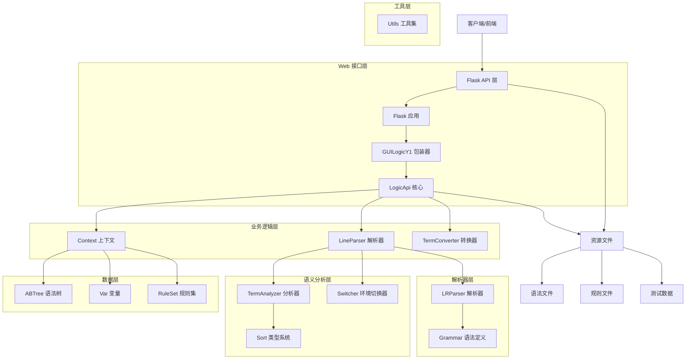

### 2.2 组件依赖矩阵

| 组件 | 依赖的内部模块 | 依赖的外部库 | 功能描述 |
|------|----------------|--------------|----------|
| `logic_flask.py` | `logic_y1`, `GUILogicY1` | Flask, Flask-CORS | Web API 入口，定义 REST 端点 |
| `logic_y1.py` | `LogicApi` | - | API 包装器，初始化推理引擎 |
| `LogicApi` | `Context`, `LineParser`, `TermConverter` | - | 核心推理逻辑，提供 12 种推理操作 |
| `Context` | `ABTree`, `Var`, `Sort` | - | 推理环境状态管理 |
| `LineParser` | `LRParser`, `Grammar`, `Word` | - | 词法语法分析，生成语法树 |
| `TermConverter` | `ABTree`, `basiccopy` | - | 语法树转换和操作 |
| `TermAnalyzer` | `Context`, `Sort` | - | 语义分析和类型检查 |
| `ABTree` | - | `Structure.Tree` | 抽象语法树数据结构 |
| `Sort` | - | - | 类型系统实现 |
| `LRParser` | `Grammar`, `ABTree` | `pandas`, `Structure.DiGraph` | LR(1) 语法解析器 |

### 2.3 外部依赖说明

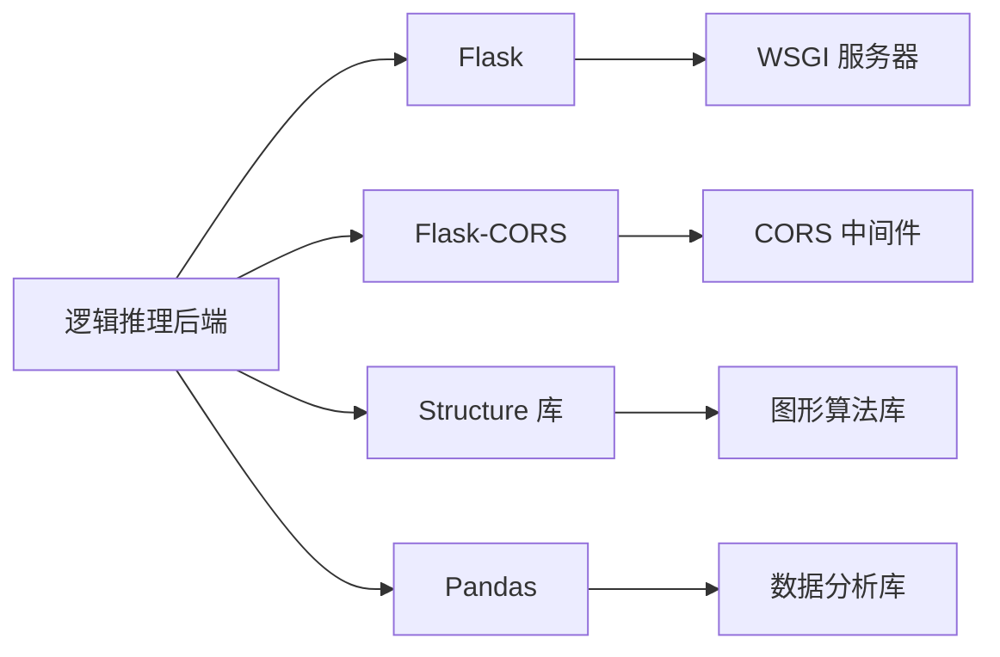

## 3. 功能组成

### 3.1 核心功能模块

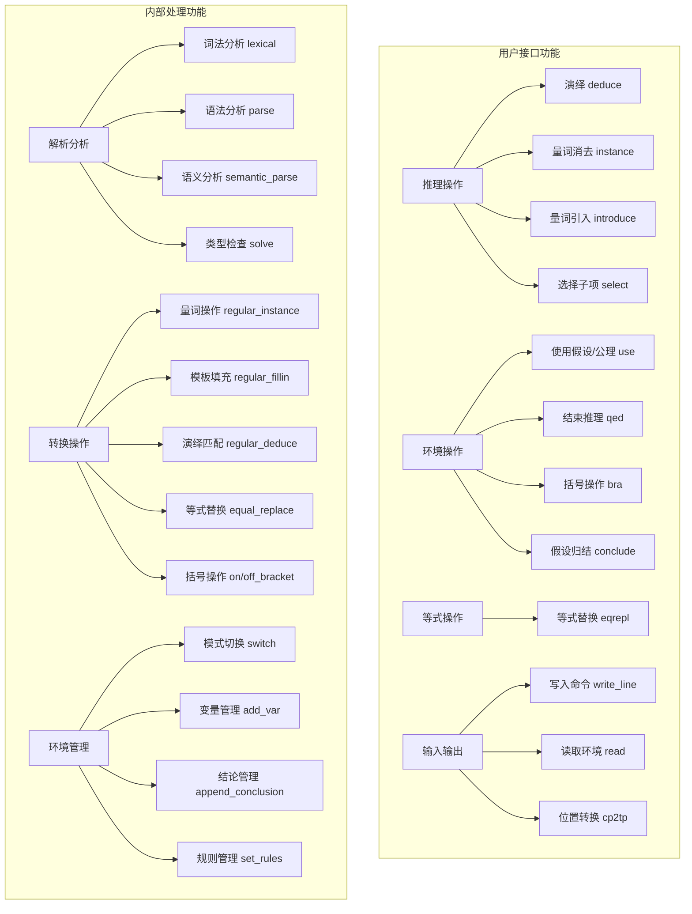

### 3.2 功能详细说明

#### 3.2.1 推理操作组
- **演绎 (deduce)**：基于推理规则从前提推导结论
- **量词消去 (instance)**：将全称/存在量词替换为具体实例
- **量词引入 (introduce)**：为自由变量添加量词约束
- **选择子项 (select)**：从结论中选择子项作为辅助项

#### 3.2.2 环境操作组
- **使用假设/公理 (use)**：将假设、公理或定理引入当前推理
- **结束推理 (qed)**：完成定理证明，清理局部环境
- **括号操作 (bra)**：添加或去除表达式中的括号
- **假设归结 (conclude)**：将多个假设归结为蕴含式

#### 3.2.3 等式操作组
- **等式替换 (eqrepl)**：基于等式在表达式中进行替换

#### 3.2.4 输入输出组
- **写入命令 (write_line)**：输入定义、公理或开始证明
- **读取环境 (read)**：获取当前推理环境的状态信息
- **位置转换 (cp2tp)**：字符位置与 token 位置的相互转换

## 4. 业务逻辑流程

### 4.1 总体业务流程

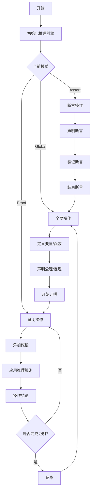

### 4.2 推理模式状态机

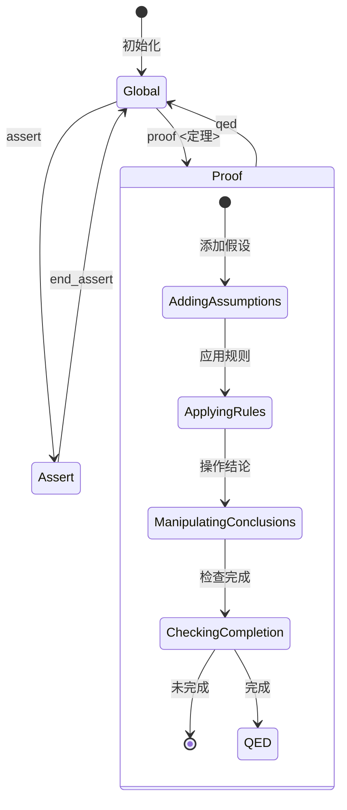

### 4.3 典型用例流程

#### 4.3.1 定理证明流程
```
1. 全局模式: 定义相关概念和公理
2. 开始证明: 输入待证定理，进入证明模式
3. 添加假设: 引入证明所需的假设
4. 逐步推理: 应用推理规则，操作结论
5. 检查匹配: 验证当前结论是否与定理匹配
6. 证毕返回: 完成证明，返回全局模式
```

#### 4.3.2 等式替换流程
```
1. 选择等式: 从结论区选择等式结论
2. 选择目标: 选择要替换的结论和子项位置
3. 确定侧边: 指定被替换项在等式的哪一侧
4. 执行替换: 系统进行语法树替换操作
5. 更新环境: 将新结论添加到结论区
```

## 5. 调用链分析

### 5.1 API 调用链总览

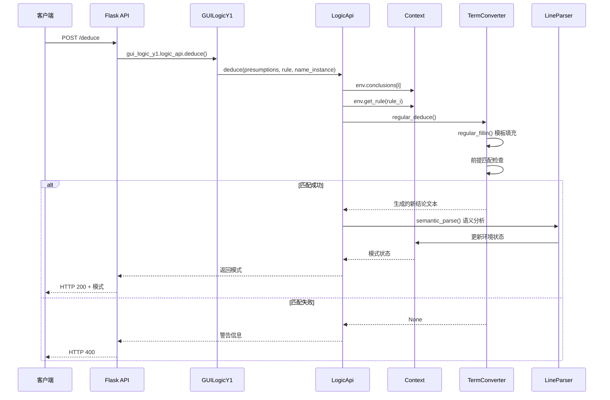

### 5.2 关键调用链详情

#### 5.2.1 量词消去调用链
```
interface/logic_flask.py:instance()
  → interface/logic_y1.py:gui_logic_y1.logic_api.instance()
    → semantic/logic_api.py:LogicApi.instance()
      → Context.conclusions[conclusion_id]           # 获取结论
      → Context.terms[i]                             # 获取项实例
      → TermConverter.regular_instance()             # 执行消去
        → ABTree.copy()                              # 复制语法树
        → regular_replace()                          # 替换操作
      → LogicApi.switch_line()                       # 环境切换
        → LineParser.parse()                         # 解析新行
        → TermAnalyzer.solve()                       # 语义分析
        → Switcher.switch()                          # 更新环境
```

#### 5.2.2 环境读取调用链
```
interface/logic_flask.py:read()
  → interface/logic_y1.py:gui_logic_y1.logic_api.env.read()
    → semantic/context.py:Context.read()
      → 根据请求项过滤数据
      → 应用映射函数转换数据格式
      → 返回结构化环境信息
```

## 6. 时序过程

### 6.1 完整推理会话时序

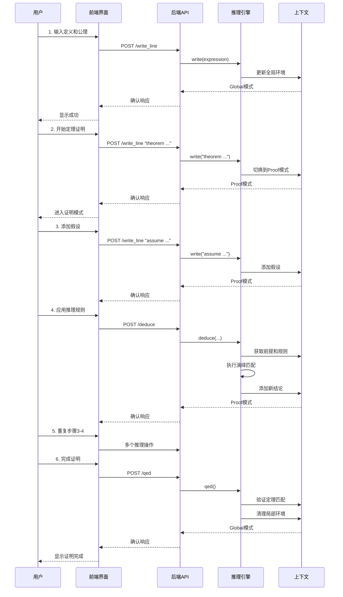

### 6.2 并发处理时序

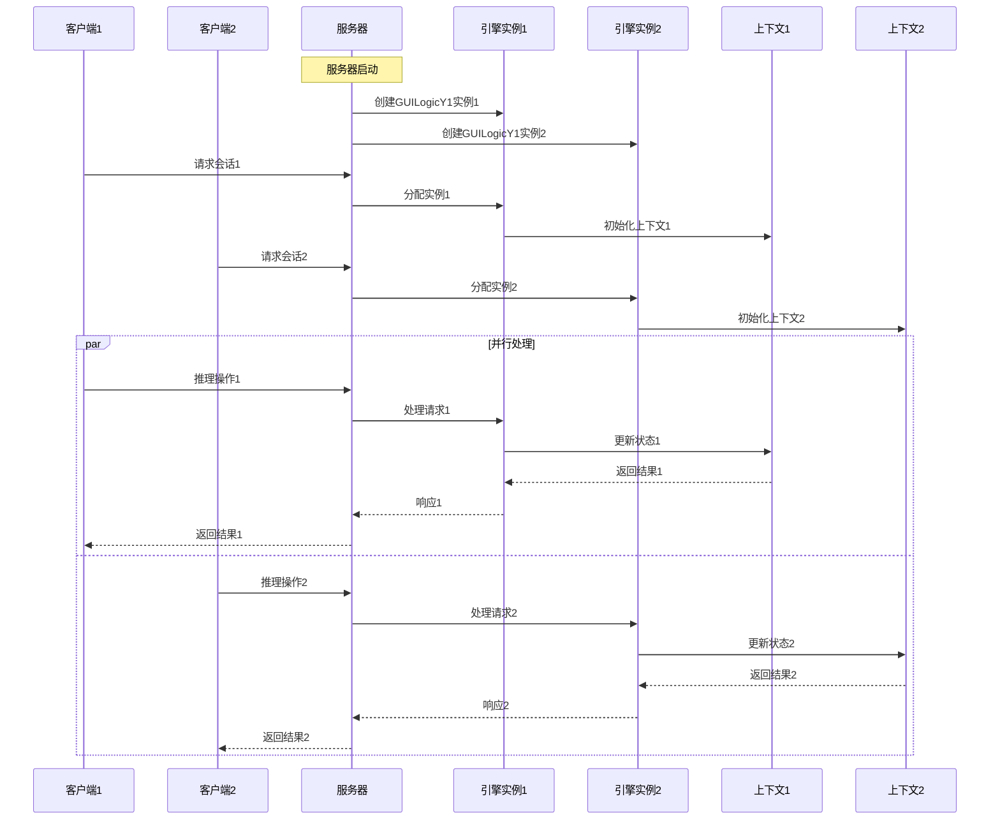

## 7. 类图设计

### 7.1 核心类关系图

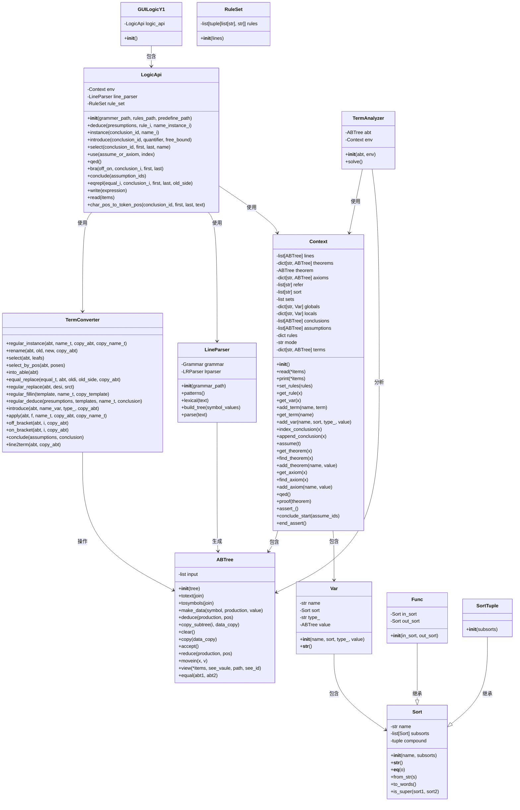

### 7.2 类详细说明

#### 7.2.1 核心数据类
- **`ABTree`**：抽象语法树，继承自 `Structure.Tree`，表示逻辑表达式的树状结构
- **`Var`**：变量语义表示，包含名称、类型、指代类型和可选值
- **`Sort`**：类型系统，支持嵌套类型和子类型关系
- **`Context`**：推理环境，管理所有推理状态和数据

#### 7.2.2 业务逻辑类
- **`LogicApi`**：核心推理逻辑，实现所有推理操作
- **`TermConverter`**：语法树转换工具，实现各种逻辑转换操作
- **`LineParser`**：解析器，将文本转换为语法树
- **`TermAnalyzer`**：语义分析器，进行类型检查和语义分析

#### 7.2.3 辅助类
- **`RuleSet`**：规则集管理
- **`Func`**：函数类型，继承自 `Sort`
- **`SortTuple`**：元组类型，继承自 `Sort`

## 8. 数据模型

### 8.1 实体关系模型

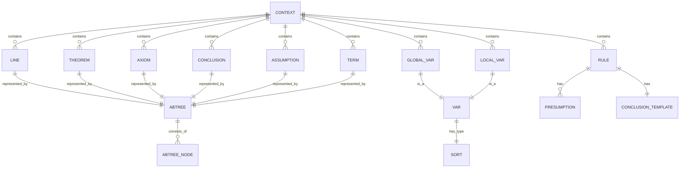

### 8.2 详细数据结构

#### 8.2.1 上下文数据结构
```python
Context = {
    "lines": List[ABTree],           # 输入历史
    "theorems": Dict[str, ABTree],   # 已证定理
    "theorem": ABTree,               # 当前待证定理
    "axioms": Dict[str, ABTree],     # 公理集合
    "refer": List[str],              # 指代类型 ["any","one","bound"]
    "sort": List[str],               # 基本类型 ["Set","Prop","Math","Tuple","Func","M"]
    "sets": List,                    # 自定义集合
    "globals": Dict[str, Var],       # 全局变量
    "locals": Dict[str, Var],        # 局部变量
    "conclusions": List[ABTree],     # 局部结论
    "assumptions": List[ABTree],     # 假设列表
    "rules": Dict[str, Tuple[List[ABTree], ABTree]],  # 推理规则
    "mode": str,                     # 模式 ["Proof", "Assert", "Global"]
    "terms": Dict[str, ABTree]       # 辅助项
}
```

#### 8.2.2 变量数据结构
```python
Var = {
    "name": str,           # 变量名
    "sort": Sort,          # 数学类型
    "type_": str,          # 指代类型 "any"|"one"|"bound"
    "value": ABTree        # 可选值
}
```

#### 8.2.3 语法树节点数据结构
```python
ABTreeNode = {
    "symbol": str,         # 语法符号
    "production": List[str], # 产生式（非叶子节点）
    "value": str,          # 值（叶子节点）
    # 语义分析附加属性
    "sort": Sort,          # 类型
    "free": Dict[str, List[int]], # 自由变量
    "appear": Dict[str, List[int]], # 出现位置
    # 其他分析属性
}
```

#### 8.2.4 规则数据结构
```python
Rule = {
    "presumptions": List[ABTree],  # 前提模板
    "conclusion": ABTree           # 结论模板
}
```

### 8.3 数据流模型

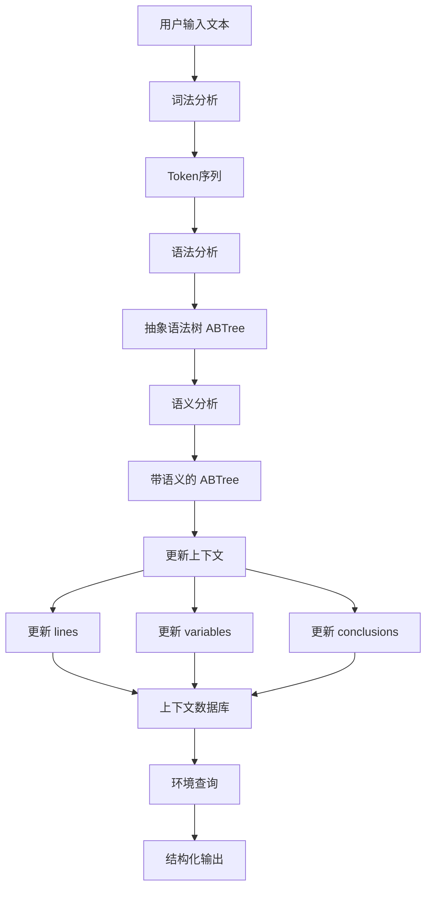

## 9. 数据流动

### 9.1 数据流动总览

系统数据流动遵循 **请求-处理-响应** 模式，数据在多个层次间传递和转换：

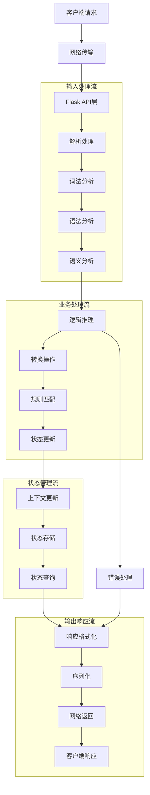

### 9.2 详细数据流路径

#### 9.2.1 请求处理数据流

**路径**: 客户端 → 网络 → Flask → 逻辑API → 解析器 → 上下文

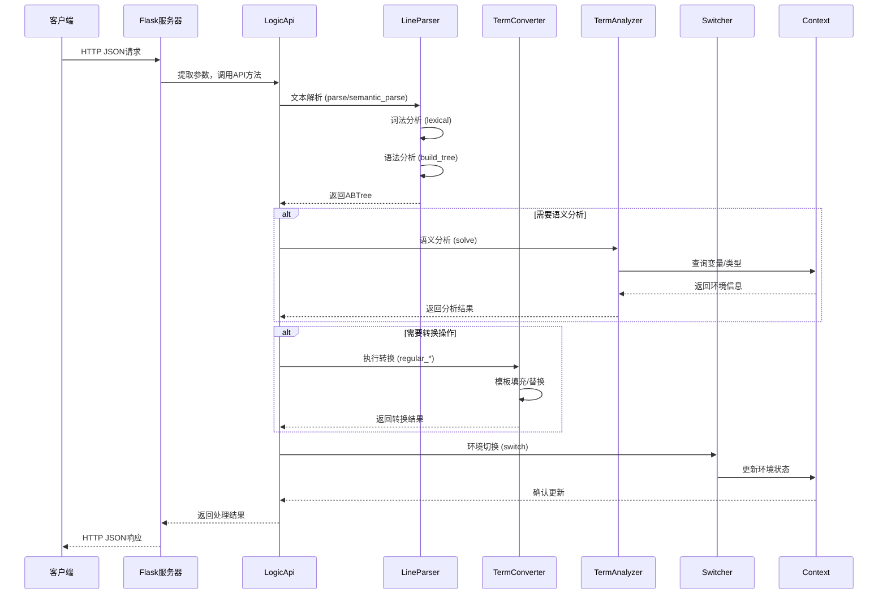

#### 9.2.2 状态更新数据流

**路径**: 推理操作 → 环境更新 → 状态持久化

```
操作执行 → 状态变更 → 环境更新 → 内存存储
    ↓
日志记录 → 结论追加 → 变量更新 → 模式切换
```

**关键状态更新点**:
1. **变量定义**: `add_var()` → `Context.globals/locals` 更新
2. **结论添加**: `append_conclusion()` → `Context.conclusions` 追加
3. **假设管理**: `assume()` → `Context.assumptions` 更新
4. **定理证明**: `proof()/qed()` → `Context.theorem/theorems` 更新
5. **模式切换**: `switch_line()` → `Context.mode` 变更

#### 9.2.3 查询响应数据流

**路径**: 查询请求 → 环境读取 → 数据格式化 → 响应返回

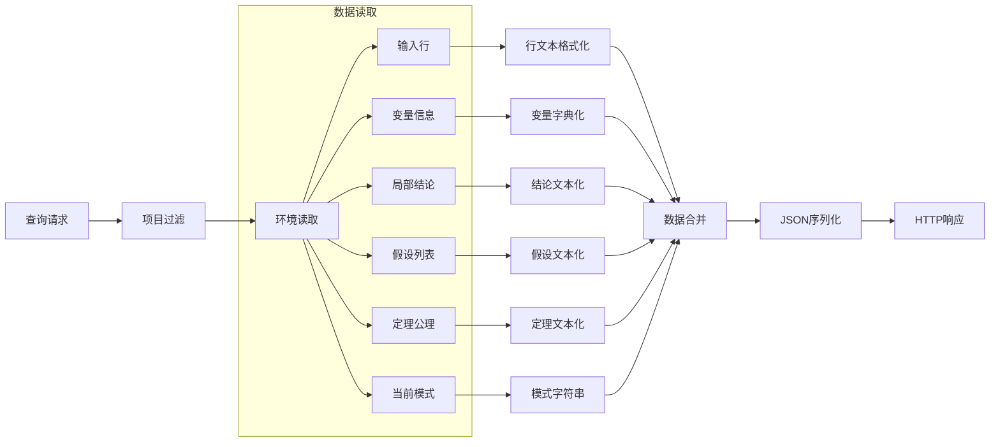

### 9.3 数据类型转换

#### 9.3.1 文本到语法树的转换
```
原始文本 → Token序列 → 语法树节点 → 抽象语法树
   ↓          ↓            ↓            ↓
用户输入   词法分析     语法分析     语义分析
```

**转换过程**:
1. **文本规范化**: 去除多余空格，统一符号表示
2. **词法分析**: 文本 → `[(symbol, value), ...]` Token序列
3. **语法分析**: Token序列 → ABTree (带产生式信息)
4. **语义分析**: 原始ABTree → 带语义属性的ABTree

#### 9.3.2 语法树到文本的转换
```
抽象语法树 → 节点遍历 → 值提取 → 文本拼接
   ↓           ↓          ↓         ↓
树结构     深度优先    叶子节点   连接符
```

**转换函数**: `ABTree.totext(join=" ")`
- 遍历所有叶子节点，提取 `value` 属性
- 使用指定连接符拼接为字符串

#### 9.3.3 环境数据的序列化
```
内存对象 → 字典转换 → JSON序列化 → 网络传输
   ↓          ↓           ↓           ↓
Context     read()     jsonify    HTTP响应
```

**序列化路径**:
- `Context.read()`: 对象 → 字典
- `flask.jsonify()`: 字典 → JSON字符串
- HTTP响应: JSON字符串 → 网络数据包

### 9.4 数据持久化与状态管理

#### 9.4.1 内存状态管理
- **全局状态**: `Context` 单例实例，生命周期与服务器相同
- **会话状态**: 通过 `GUILogicY1` 实例隔离不同客户端会话
- **临时状态**: 推理过程中的中间结果存储在 `Context.terms`

#### 9.4.2 数据一致性保证
1. **原子操作**: 每个API调用是原子的环境更新操作
2. **状态验证**: 操作前验证前提条件，如模式检查、变量存在性
3. **错误回滚**: 操作失败时保持环境状态不变
4. **完整性检查**: `qed()` 时验证定理证明的完整性

#### 9.4.3 性能优化策略
1. **语法树共享**: 使用 `basiccopy` 进行最小化复制
2. **延迟计算**: 语义分析在需要时进行
3. **缓存优化**: 解析结果在会话内缓存
4. **批量操作**: 支持多前提的推理操作

### 9.5 错误处理数据流

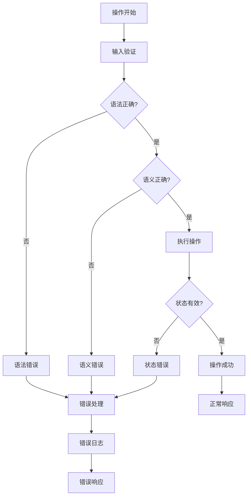

**错误类型处理**:
1. **语法错误**: 返回HTTP 400，包含具体语法问题描述
2. **语义错误**: 返回HTTP 422，包含类型/变量错误信息
3. **状态错误**: 返回HTTP 409，包含状态冲突描述
4. **内部错误**: 返回HTTP 500，简化错误信息

## 11. 关键算法

### 11.1 算法概览

```mermaid
graph TB
    A1[LR(1) 语法分析] --> B1[自底向上规约]
    A2[语义分析算法] --> B2[类型推导]
    A3[模板匹配算法] --> B3[多模式匹配]
    A4[替换算法] --> B4[树结构操作]
    A5[类型检查算法] --> B5[子类型关系判断]

    B1 --> C1[语法树构建]
    B2 --> C2[变量解析]
    B3 --> C3[规则应用]
    B4 --> C4[表达式转换]
    B5 --> C5[类型安全]

    C1 --> D[可执行推理]
    C2 --> D
    C3 --> D
    C4 --> D
    C5 --> D
```

### 11.2 详细算法说明

#### 11.2.1 LR(1) 语法分析算法
- **位置**: `lrparser.py`
- **复杂度**: O(n) 时间复杂度
- **关键步骤**:
  1. 构建 LR(1) 分析表
  2. 使用栈进行移入-规约分析
  3. 处理运算符优先级和结合性
  4. 生成抽象语法树

```python
def parse(self, symbol_values, meaning=True):
    """
    LR(1) 解析算法实现
    输入: token序列 [(symbol, value), ...]
    输出: 抽象语法树 ABTree
    """
    stack = [0]  # 状态栈
    abt = ABTree()
    # ... 移入-规约过程
    return abt
```

#### 11.2.2 语义分析算法
- **位置**: `semantic/line.py` - `TermAnalyzer`
- **功能**: 类型检查、变量解析、自由变量计算
- **关键步骤**:
  1. 遍历语法树，收集变量信息
  2. 类型推导和检查
  3. 解析变量引用
  4. 计算自由变量集合

#### 11.2.3 模板匹配算法
- **位置**: `semantic/convert.py` - `regular_deduce`
- **功能**: 将前提实例与规则模板进行匹配
- **算法**:
  ```python
  def regular_deduce(presumptions, templates, name_t, conclusion):
      # 1. 使用 name_t 填充模板
      filled_templates = [regular_fillin(tmp, name_t) for tmp in templates]

      # 2. 将前提转换为字符串
      presumption_strs = [abt.totext(" ") for abt in presumptions]

      # 3. 精确匹配
      if presumption_strs == filled_templates:
          # 4. 填充结论模板
          return regular_fillin(conclusion, name_t)
      else:
          return None
  ```

#### 11.2.4 替换算法
- **位置**: `semantic/convert.py` - `regular_replace`
- **功能**: 在语法树中进行安全替换
- **特点**:
  - 自动添加括号保证语法正确性
  - 支持深度替换
  - 保持树结构完整性

#### 11.2.5 类型检查算法
- **位置**: `semantic/sort.py` - `is_super`
- **功能**: 判断子类型关系
- **算法**: 递归检查类型名称和子类型

```python
def is_super(sort1, sort2):
    if sort1.name == sort2.name:
        if sort1.subsorts:
            if sort2.subsorts:
                # 递归检查子类型
                return all(is_super(sub1, sub2)
                          for sub1, sub2 in zip(sort1.subsorts, sort2.subsorts))
            else:
                return False
        else:
            return True
    else:
        return False
```

### 11.3 算法性能特征

| 算法 | 时间复杂度 | 空间复杂度 | 关键优化 |
|------|------------|------------|----------|
| LR(1) 解析 | O(n) | O(n) | LR(1) 表预计算 |
| 语义分析 | O(n) | O(n) | 树遍历优化 |
| 模板匹配 | O(k·m) | O(k) | 字符串哈希比较 |
| 树替换 | O(h) | O(1) | 原地修改 |
| 类型检查 | O(d) | O(1) | 递归深度优化 |

## 12. 附录

### 12.1 数据/配置示例

#### 12.1.1 语法文件示例 (`resource/grammars/line.txt`)
```
<line> ::= <term>
<term> ::= <term> ∀ <varT_list> <term>
<term> ::= <term> ∃ <varT_list> <term>
<term> ::= <term> λ <varT_list> . <term>
<term> ::= <term> -> <term>
<term> ::= <term> <-> <term>
<term> ::= <term> ∧ <term>
<term> ::= <term> ∨ <term>
<term> ::= ¬ <term>
<term> ::= ( <term> )
<term> ::= { <var> : <term> | <term> }
<term> ::= <term> = <term>
<term> ::= <term> ∈ <term>
<term> ::= <var>
<term> ::= <num>
<varT_list> ::= <varT> ,
<varT_list> ::= <varT_list> <varT> ,
<varT> ::= <var> : <sort>
<sort> ::= <name> [ <sort_list> ]
<sort_list> ::= <sort> ,
<sort_list> ::= <sort_list> <sort> ,
```

#### 12.1.2 规则文件示例 (`resource/first-order/rules.txt`)
```
{p} |- p∨q
{q} |- p∨q
{p,q} |- p∧q
{p, p->q} |- q
{p->q, q->r} |- p->r
{p} |- p
```

#### 12.1.3 预定义文件示例 (`resource/test/sentences/predefine2.txt`)
```
one Union := λ A : Set[Set,], . { x : Math | ∃ a : A , x ∈ a }
one N : Set
one ADD : Func[Tuple[N,N,],N,]
one _0 : N
∀ x :N, (ADD (x,_0,)) = x
```

#### 12.1.4 API 请求/响应示例

**请求示例 (演绎推理)**:
```json
{
  "presumptions": [0, 1],
  "rule": 3,
  "name_instance": {
    "p": 2,
    "q": 3
  }
}
```

**响应示例**:
```json
"Proof"
```

**环境读取请求**:
```json
{
  "items": ["LN", "TH", "CC", "AS"]
}
```

**环境读取响应**:
```json
{
  "LN": ["∀ x : N, x = x", "one a : N"],
  "TH": "∀ x : N, x = x",
  "CC": ["a = a"],
  "AS": ["a : N"]
}
```

### 12.2 接口规范摘要

#### 12.2.1 端点列表
| 端点 | 方法 | 描述 | 输入参数 |
|------|------|------|----------|
| `/deduce` | POST | 逻辑推理 | presumptions, rule, name_instance |
| `/instance` | POST | 量词消去 | conclusion_id, name_instance |
| `/introduce` | POST | 量词引入 | conclusion_id, quantifier, free_bound |
| `/select` | POST | 选择辅助项 | conclusion_id, first, last, name |
| `/use` | POST | 引入假设/定理公理 | assume_or_axiom, index |
| `/qed` | POST | 结束推理 | 无 |
| `/bra` | POST | 添/去括号 | off_on, conclusion_id, first, last |
| `/conclude` | POST | 假设归结 | assumption_ids |
| `/eqrepl` | POST | 等式替换 | equal_id, conclusion_id, first, last, old_side |
| `/write_line` | POST | 写入用户命令 | expression |
| `/read` | POST | 读取环境信息 | items |
| `/cp2tp` | POST | 字符位置转token位置 | conclusion_id, first, last, text |

#### 12.2.2 错误处理
- **成功响应**: HTTP 200 + 当前模式字符串
- **语法错误**: HTTP 400 + 错误信息
- **语义错误**: HTTP 422 + 详细错误描述
- **内部错误**: HTTP 500 + 简化错误信息

### 12.3 开发与测试

#### 12.3.1 测试文件结构
```
test/
├── test_analyser.py          # 语义分析器测试
├── test_axiom.py             # 公理测试
├── test_bracket.py           # 括号操作测试
├── test_char_pos_to_token_pos.py # 位置转换测试
├── test_commander.py         # 命令处理器测试
├── test_context_vert.py      # 上下文验证测试
├── test_converter.py         # 转换器测试
├── test_deduce.py            # 推理测试
├── test_eq_replace.py        # 等式替换测试
├── test_logicY0.py           # 逻辑接口测试
├── test_parser.py            # 解析器测试
├── test_sort.py              # 类型系统测试
└── test_term_converter.py    # 项转换器测试
```

#### 12.3.2 运行测试
```bash
# 运行所有测试
python test.py

# 运行特定测试模块
python -m pytest test/test_deduce.py

# 启动开发服务器
python interface/logic_flask.py
```

### 12.4 部署配置

#### 12.4.1 环境变量 (`.env`)
```
DEBUG=true
HOST=0.0.0.0
PORT=5000
GRAMMAR_PATH=resource/grammars/line.txt
RULES_PATH=resource/first-order/rules.txt
PREDEFINE_PATH=resource/test/sentences/predefine2.txt
```

#### 12.4.2 依赖管理
```txt
Flask>=2.3.0
Flask-CORS>=4.0.0
pandas>=2.0.0
# Structure 库为本地依赖
```

---

**文档版本**: 1.0
**生成日期**: 2026-01-02
**基于代码版本**: da6f361 (backend of logic-y2 using flask as controller)
**文档状态**: 已完成逆向生成设计文档