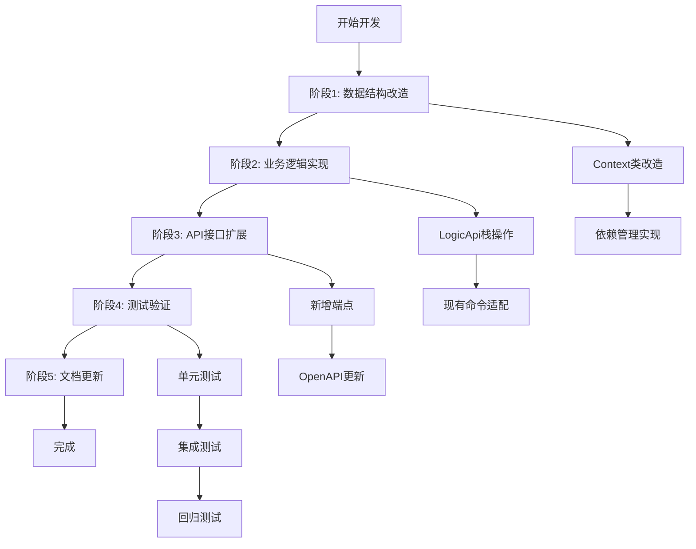

# 支持假设栈开发规划

## 概览

### 需求概览

**问题背景**：现有逻辑推理系统使用扁平假设池 (`assumptions: list[ABTree]`)，无法表达嵌套的假设上下文。在复杂定理证明中，需要支持假设栈结构，允许假设的压栈和弹栈操作，并管理基于假设的结论依赖关系。

**解决方案**：将扁平假设池改为栈结构 (`assumption_stack: list[ABTree]`)，每层一个假设，支持`push`/`pop`操作，并简化结论依赖管理（只记录结论推导时的栈顶层索引）。

**设计目标**：
1. **向后兼容**：单层上下文时与现有系统行为完全一致
2. **操作简化**：每层一个假设，所有栈内假设均可见
3. **依赖简化**：结论只记录推导时的栈顶层索引，`pop`时清理依赖结论
4. **接口扩展**：新增`/manage_assumption`端点支持栈操作

**关键设计决策**（来自`analyse-design.md`）：
1. **数据结构**：使用`list[ABTree]`表示栈，列表顺序即栈结构（索引0=栈底）
2. **可见性**：所有栈内假设对所有操作均可见，无需可见性检查
3. **依赖管理**：`Dict[int, int]`映射（结论ID → 栈顶层索引），`pop`时清理依赖层索引≥当前层索引的结论
4. **assume语义**：始终是新增假设，在栈上下文中等价于`push`
5. **API兼容**：现有`/read`接口不变，栈结构通过假设列表顺序自然表示
6. **错误处理**：简单错误处理，不实现复杂的原子性保证
7. **栈深度**：无限制，使用Python列表天然容量
8. **部署策略**：直接替换数据结构，依赖单层兼容性

### 开发活动概览



**开发活动全景**：
1. **数据结构层**：修改`Context`类，实现假设栈和简化依赖管理
2. **业务逻辑层**：在`LogicApi`中实现栈操作逻辑，适配现有命令
3. **接口层**：新增`/manage_assumption`端点，更新OpenAPI规范
4. **测试层**：全面测试栈行为，确保向后兼容
5. **文档层**：更新接口文档和设计文档

## 开发活动规划

### 阶段1：数据结构改造（核心修改）

#### 1.1 Context类改造 (`semantic/context.py`)
**目标**：将扁平假设池改为栈结构，实现简化依赖管理

**具体任务**：
1. **属性重命名与新增**：
   - 将`self.assumptions: list[ABTree]`改为`self.assumption_stack: list[ABTree]`
   - 新增`self.conclusion_deps: Dict[int, int]`（结论ID → 栈顶层索引）
   - 新增`self.stack_depth: int`属性（可由`len(self.assumption_stack)`推导，但为清晰保留）

2. **栈操作方法实现**：
   - `push_assumption_layer(term: ABTree) -> int`：压栈操作，返回新栈顶索引
   - `pop_assumption_layer() -> Optional[ABTree]`：弹栈操作，清理依赖结论
   - `get_stack_layers() -> List[ABTree]`：获取所有栈层（全部可见）

3. **依赖管理方法**：
   - `record_conclusion_dependency(conclusion_id: int)`：记录结论依赖当前栈顶
   - `clean_layer_dependencies(layer_index: int) -> List[int]`：清理依赖指定层及更深层的结论
   - `get_dependent_conclusions(layer_index: int) -> List[int]`：查询依赖指定层的结论

4. **现有方法适配**：
   - `assume(t: ABTree)`：改为调用`push_assumption_layer(t)`
   - `read()`方法：保持现有格式，假设列表(`AS`项)顺序表示栈结构
   - `qed()`方法：清空整个栈和依赖映射

**兼容性保证**：
- 单层栈时，`self.assumption_stack`与原有`self.assumptions`行为一致
- `read()`返回的假设列表顺序即栈结构，兼容现有前端

#### 1.2 依赖管理实现细节
**简化依赖规则**：
- 结论推导时，记录当前栈顶索引：`conclusion_deps[conclusion_id] = stack_depth - 1`
- `pop`操作时，清理所有`dep_layer_index >= layer_index`的结论
- 结论ID机制：使用现有系统生成的结论ID（`Context.conclusions`列表索引）

**数据结构定义**：
```python
# 当前状态（改造后）
self.assumption_stack: list[ABTree] = []      # 假设栈，每层一个ABTree
self.conclusions: list[ABTree] = []           # 结论列表（保持现有）
self.conclusion_deps: Dict[int, int] = {}     # 结论依赖映射 {结论ID: 栈顶层索引}
self.stack_depth: int = 0                     # 栈深度跟踪（= len(assumption_stack)）
```

### 阶段2：业务逻辑实现 (`semantic/logic_api.py`)

#### 2.1 栈操作业务逻辑
**目标**：在`LogicApi`类中实现`push`/`pop`业务逻辑

**具体任务**：
1. **新增栈操作方法**：
   - `push_assumption(term: str) -> Dict`：验证模式，解析term，调用Context压栈
   - `pop_assumption() -> Dict`：验证栈非空，调用Context弹栈，返回操作结果

2. **模式验证逻辑**：
   - 栈操作仅在`Proof`模式下可用
   - 错误响应：`{"status": "error", "error_code": "INVALID_MODE", ...}`

3. **参数验证逻辑**：
   - `push`：验证term可解析为有效的ABTree
   - `pop`：验证栈非空（`stack_depth > 0`）

4. **错误处理**：
   - 保持与现有系统一致的错误处理方式
   - 错误响应包含当前栈深度信息

#### 2.2 现有命令适配
**assume命令兼容**：
- `assume`命令已通过Context.assume()适配为`push`操作
- 在栈上下文中，`assume`总是创建新层（等价于`push`）

**conclude命令适配**：
- `conclude`操作引用假设时，使用栈索引（0-based）
- 所有栈内假设均可见，无需修改引用逻辑

**use命令适配**：
- 引用假设时使用栈索引，兼容现有索引机制
- 可见性规则：所有栈内假设均可见

### 阶段3：API接口扩展 (`interface/`目录)

#### 3.1 新增端点 (`interface/logic_flask.py`)
**目标**：实现`/manage_assumption`端点

**具体任务**：
1. **端点定义**：
   - `POST /manage_assumption`：支持`push`和`pop`操作
   - 请求体：`{"action": "push", "term": "P → Q"}` 或 `{"action": "pop"}`
   - 响应格式：成功时包含`stack_depth`和`current_layer`，错误时包含错误码和栈深度

2. **请求处理流程**：
   - 解析action参数，验证合法性（"push"或"pop"）
   - 调用`LogicApi.push_assumption()`或`LogicApi.pop_assumption()`
   - 格式化响应，包含操作后的栈状态

3. **错误响应格式**：
   ```json
   {
     "status": "error",
     "error_code": "INVALID_MODE",
     "message": "栈操作仅在Proof模式下可用（当前模式：{current_mode}）",
     "stack_depth": 1
   }
   ```

#### 3.2 OpenAPI规范更新 (`interface/interface.yaml`)
**目标**：更新接口文档，包含新端点

**具体任务**：
1. **添加新端点定义**：
   - `POST /manage_assumption`的请求/响应模式
   - 错误响应模式定义
   - 参数描述和示例

2. **更新现有端点说明**：
   - `/read`端点：说明假设列表顺序表示栈结构
   - `/use`端点：说明索引引用栈层假设

### 阶段4：语法层兼容修改

#### 4.1 Switcher适配 (`semantic/line.py`)
**目标**：确保`assume`命令在栈上下文中正常工作

**具体任务**：
- 检查`Switcher`处理`assume`命令的现有逻辑
- 确保`assume`命令调用`Context.assume()`，后者已适配为`push`
- 无需实质性修改，仅需验证兼容性

#### 4.2 TermConverter适配 (`semantic/convert.py`)
**目标**：适配栈过滤逻辑（如需要）

**具体任务**：
- 检查`conclude`操作中的假设过滤逻辑
- 确保使用栈索引引用时工作正常
- 所有栈内假设均可见，无需可见性过滤

### 阶段5：测试验证

#### 5.1 单元测试扩展 (`test/test_axiom.py`及其他)
**目标**：全面测试栈行为

**测试矩阵**：
| 测试维度 | 测试场景 | 验证点 |
|---------|---------|--------|
| 栈操作 | push/pop序列 | 深度变化、状态一致 |
| 假设引用 | 跨层引用 | 正确引用任意栈层假设 |
| 依赖管理 | pop时结论清理 | 简化依赖关系正确识别 |
| 错误处理 | 各种非法操作 | 正确错误响应、状态保护 |
| 向后兼容 | 单层上下文 | assume/conclude行为不变 |
| 边界条件 | 空栈操作、深度边界 | 边界行为正确 |

**具体测试用例**：
1. **基础栈操作测试**：
   - 空栈push创建层0
   - 多层级push/pop序列
   - 栈深度跟踪正确性

2. **依赖管理测试**：
   - 结论推导时依赖记录
   - pop时依赖结论清理
   - 多层pop时的级联清理

3. **向后兼容测试**：
   - 单层栈时assume行为
   - 单层栈时conclude行为
   - 单层栈时use命令引用

4. **错误处理测试**：
   - 非Proof模式下的栈操作
   - 空栈时的pop操作
   - 无效term的push操作

#### 5.2 集成测试
**目标**：端到端测试API行为

**测试场景**：
1. 完整栈操作流程（push → 推理 → pop）
2. 嵌套假设上下文中的定理证明
3. 现有功能回归测试

### 阶段6：文档更新

#### 6.1 设计文档更新
**目标**：将开发实现反映到设计文档

**具体任务**：
- 更新`analyse-design.md`中的实现细节
- 添加代码片段示例
- 记录关键实现决策

#### 6.2 接口文档更新
**目标**：确保接口文档与实际实现一致

**具体任务**：
- 验证`interface.yaml`与代码实现一致
- 添加新端点使用示例
- 更新现有端点说明（栈结构表示）

## Q&A

### Q1: 结论ID的生成机制是什么？
**当前系统实现**：结论ID是`Context.conclusions`列表的索引（0-based）。添加新结论时使用`append_conclusion()`，返回的列表位置即结论ID。

**开发注意事项**：
- 依赖映射使用现有结论ID机制
- `pop`清理结论时，需要从`conclusions`列表移除对应元素，并调整后续元素的索引
- 或者保持结论列表不变，仅标记清理（需根据现有系统行为决定）

**待确认**：需要检查现有系统如何处理结论移除（如`qed`时），以保持一致。

### Q2: `/read` API现有格式的具体内容？
**当前响应格式**（来自`backend-logic-y2-topview.md`）：
```json
{
  "LN": ["∀ x : N, x = x", "one a : N"],
  "TH": "∀ x : N, x = x",
  "CC": ["a = a"],
  "AS": ["a : N"]
}
```

**开发注意事项**：
- `AS`项（假设列表）顺序将表示栈结构：索引0=栈底，最后一项=栈顶
- 无需修改`Context.read()`方法，只需确保`assumption_stack`顺序正确
- 栈深度 = `len(AS)`
- 当前层索引 = `len(AS) - 1`

### Q3: 错误响应格式与现有系统的一致性？
**现有错误处理模式**（观察代码需要确认）：
- 需要检查`logic_flask.py`中现有端点的错误响应格式
- 确保新端点错误响应格式与系统保持一致

**开发策略**：
- 先检查现有错误响应格式
- 设计相似的错误响应结构
- 包含栈深度信息用于调试

### Q4: assume命令的具体调用路径？
**需要确认的调用链**：
```
assume命令 → Switcher.switch() → Context.assume() → push_assumption_layer()
```

**开发验证**：
- 需要跟踪`assume`命令的实际处理流程
- 确保`Context.assume()`方法已正确适配为栈操作
- 验证在栈上下文中`assume`总是创建新层

### Q5: 测试覆盖的充分性标准？
**测试验收标准**：
1. 所有栈操作功能正常工作
2. 简化依赖管理正确实现
3. 向后兼容性得到验证
4. 错误处理符合预期
5. 性能表现可接受（无显著退化）

**测试执行策略**：
- 优先编写单元测试，覆盖核心算法
- 进行集成测试，验证端到端行为
- 运行现有测试套件，确保无回归

## 参考

### 参考文档
1. **需求澄清文档**：`issues-end2end/support_assumption_stack/issue.md`
2. **需求设计文档**：`issues-end2end/support_assumption_stack/analyse-design.md`（版本4.0）
3. **需求活动日志**：`issues-end2end/support_assumption_stack/log.md`
4. **系统设计文档**：`docs/backend-logic-y2-topview.md`
5. **假设推理专题文档**：`docs/subjects/hypothesis-reasoning.md`

### 相关代码文件
#### 核心修改文件（高优先级）：
- `semantic/context.py` - Context类改造（假设栈数据结构+依赖管理）
- `semantic/logic_api.py` - LogicApi类栈操作业务逻辑
- `interface/logic_flask.py` - 新增`/manage_assumption`端点
- `interface/interface.yaml` - OpenAPI规范更新

#### 测试文件：
- `test/test_axiom.py` - 栈行为测试扩展
- 其他相关测试文件回归测试

#### 兼容性文件（低优先级）：
- `semantic/line.py` - Switcher处理assume命令
- `semantic/convert.py` - TermConverter适配栈过滤

### 关键设计约束
1. **向后兼容**：单层上下文必须与现有系统行为完全一致
2. **简化实现**：不引入不必要的复杂性，聚焦核心功能
3. **数据结构**：使用`list[ABTree]`表示栈，无额外抽象层
4. **依赖管理**：简化方案，只记录栈顶层索引
5. **可见性**：所有栈内假设均可见，无需可见性检查

### 开发原则
1. **渐进式修改**：先改造数据结构，再实现业务逻辑，最后扩展接口
2. **测试驱动**：每项修改伴随相应测试，确保质量
3. **兼容性优先**：确保现有功能不受影响
4. **简化设计**：遵循设计文档的简化原则，避免过度工程

---

**文档版本**: 1.0
**生成日期**: 2026-01-03
**基于设计文档**: `analyse-design.md` v4.0
**开发目标**: 实现支持假设栈功能，满足需求澄清和设计要求