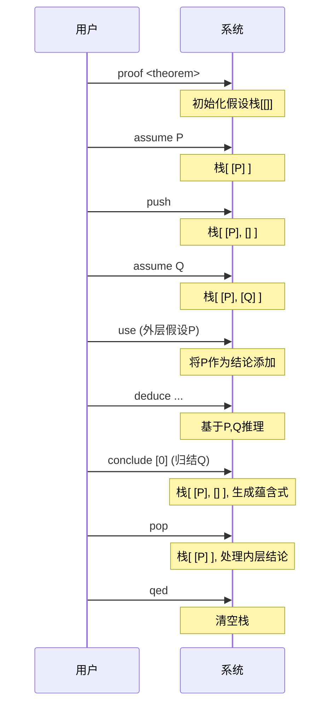
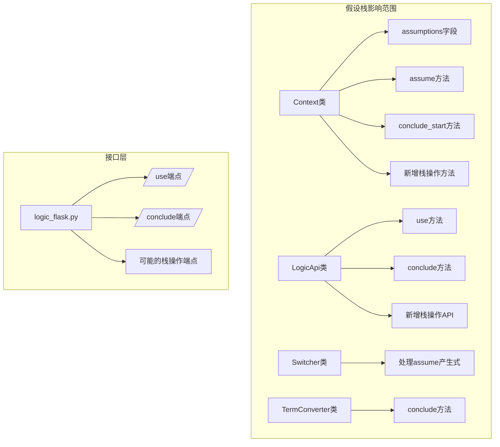

## HEAD
- time : 2026-1-2
- author : young
- abstract : 支持假设栈（嵌套的假设上下文）

## 概述
> 简要说明背景，引入需求

假设推理是本形式化推理项目的重要特性，为蕴含式推理和反证法推理提供了可能性。在形式逻辑中，假设本质上是嵌套式的：在已有假设上下文的基础上，可以再提出新的假设，外层假设在内层上下文中可以当作公理使用。

**当前问题**:
目前系统实现中使用的是扁平的假设池(`Context.assumptions: list[ABTree]`)，所有假设都存储在同一个列表中，没有体现嵌套关系。假设归结(`conclude`)操作会从池中移除选定假设并生成蕴含式，但这种设计存在以下局限性：

1. **缺乏嵌套支持**: 无法表示"在假设A的基础上再假设B"的嵌套结构
2. **作用域不清晰**: 所有假设在同一层级，无法区分不同上下文中的假设
3. **管理不灵活**: 不能临时创建假设上下文然后恢复外层状态
4. **结论依赖不明确**: 基于内层假设得出的结论在外层上下文中的状态不清晰

**需求动机**:
- 支持复杂的证明结构，如嵌套的反证法、条件证明嵌套
- 保持外层假设在内层上下文中可用（作为公理）
- 允许临时假设上下文，完成后恢复之前状态
- 明确假设和结论的作用域关系

**示例场景**:
```
1. assume P              # 设置初始假设
2. push Q                # 创建新层，假设Q，P在内层可见
3. use 0                 # 使用外层假设P（索引0）
4. deduce ...            # 基于P和Q推理R
5. conclude [0]          # 归结当前层假设Q，生成蕴含式 Q → R
6. pop                   # 弹出内层，清理基于Q的结论，恢复只有P的上下文
``` 


## asis-tobe
> 端到端的目标
### asis
> 现状

**当前假设系统**:
1. **数据结构**: `Context.assumptions: list[ABTree]` - 扁平的假设列表
2. **假设声明**: 通过 `assume <term>` 命令，Switcher处理 `<assume> assume <term>` 产生式，调用 `Context.assume()` 添加到列表末尾
3. **假设使用**: 通过 `/use` API引用假设索引，将假设复制到结论列表
4. **假设归结**: 通过 `/conclude` API指定假设索引列表，从假设池中移除这些假设并生成蕴含式
5. **作用域**: 所有假设在同一全局作用域，没有嵌套概念
6. **生命周期**: 假设在归结时从池中移除，证明结束时(`qed`)清空所有假设

**限制**:
- 无法创建嵌套的假设上下文
- 内层假设无法访问外层假设作为公理
- 不能临时创建然后恢复假设状态
- 结论与假设的依赖关系不明确

### tobe
> 目标

**假设栈系统**:
1. **数据结构**: 假设栈 - `list[ABTree]`，每层一个假设，栈顶为当前活动假设
2. **栈操作**:
   - `push (term)`: 创建新的假设层并设置假设值，外层假设在内层可见
   - `pop`: 弹出当前层，清理基于该层假设的所有结论
3. **假设声明**: `assume <term>` 设置当前层（栈顶）的假设值（与push互补）
4. **假设可见性**: 内层可以访问所有外层假设（作为公理使用）
5. **假设归结**: `conclude` 只归结当前层的假设，不影响外层
6. **结论管理**: 明确结论与假设层的依赖关系，`pop`时清理基于该层假设的结论

**核心能力**:
1. ✅ 支持嵌套假设上下文
2. ✅ 外层假设在内层作为公理可用
3. ✅ 灵活的假设生命周期管理
4. ✅ 明确的假设和结论作用域
5. ✅ 向后兼容现有 `assume` 和 `conclude` 命令


## 5w + how
> 各个维度简述需求，在issue提出阶段（本阶段），最重要的是what
### why
> 为什么需要这个特性,有没有可行性

**为什么需要假设栈**:
1. **形式逻辑的自然表达**: 在形式化证明中，假设本质上是嵌套的（如嵌套的条件证明、反证法）
2. **证明结构化的需要**: 复杂证明需要分层组织假设，临时引入假设然后恢复之前状态
3. **提升表达能力**: 支持更丰富的证明模式，如嵌套蕴含式证明、多级反证法
4. **改善用户体验**: 避免扁平假设池导致的索引混乱和状态管理困难
5. **逻辑完整性**: 正确建模假设的作用域和可见性规则

**可行性分析**:
1. **技术可行性**:
   - 当前系统已有完整的假设管理基础（assume、use、conclude）
   - 数据结构变更（列表→栈）在Python中容易实现
   - 无需修改语法解析器，可通过API扩展实现
2. **架构可行性**:
   - Context类封装了所有状态管理，修改集中
   - LogicApi提供了清晰的业务逻辑入口
   - 向后兼容可保证现有功能不受影响
3. **实现可行性**:
   - 核心变更集中在`Context`类的假设管理部分
   - 栈操作语义清晰，易于测试验证
   - 可分阶段实施，先实现基本栈结构，再完善边缘情况
### what
> 需求以及相关概念

**核心需求**:
1. **假设栈数据结构**: 将扁平的假设列表改为嵌套的栈结构，支持多级假设上下文
2. **栈操作接口**: 提供创建(push)和销毁(pop)假设层的能力
3. **假设可见性规则**: 内层可以访问所有外层假设，外层不能访问内层假设
4. **向后兼容**: 现有`assume`和`conclude`命令在单层上下文中行为不变
5. **结论依赖管理**: 明确结论与假设层的依赖关系，支持跨层结论处理

**详细需求**:

**1. 数据结构需求**:
- 假设栈: `list[ABTree]`，每层一个假设，栈顶为当前活动假设
- 栈深度表示嵌套层数，每层一个假设
- 结论可能需要记录依赖的假设层信息

**2. 操作语义**:
- **push (term)**: 创建新的假设层并设置假设值，外层假设在内层可见（可作为公理使用）
- **pop**: 弹出当前层，清理基于该层假设的所有结论
- **assume**: 历史版本实现，功能上与push等价，用于设置当前层（栈顶）的假设值
- **use**: 可以引用任何可见层的假设（包括外层），通过下标索引（栈索引）或名称引用
- **conclude**: 只归结当前层的假设，不影响外层假设

**3. 可见性规则**:
- 内层可以看到所有外层假设（全序关系）
- 假设引用通过下标索引（栈索引）定位，0表示栈底，依次递增
- 也可通过名称/元数据引用，但主要使用下标索引
- 使用外层假设时，语义上相当于将其作为公理引入

**4. 生命周期管理**:
- 每层假设独立管理，`conclude`只影响当前层
- `qed`操作清空整个栈
- `pop`操作清理基于该层假设的所有结论，不关心假设是否已归结

**5. 接口需求**:
- 新增 `/manage_assumption` API端点，支持 `push` 和 `pop` 操作
- `push` 操作带 `term` 参数表示假设内容
- `pop` 操作无参数，清理基于该层假设的结论
- 假设引用通过下标索引（栈索引）或名称，无需相对索引
- 环境读取(`read`)需要反映栈结构信息

**非功能需求**:
- 向后兼容性：现有代码和证明应继续工作
- 性能：栈操作不应显著影响推理性能
- 可测试性：提供完整的测试用例验证栈行为

### when
> 涉及的相关时机和时序

**操作时序**:

1. **栈操作时机**:
   - `push`: 在需要创建新的假设上下文时调用，如在复杂证明中开始嵌套证明
   - `pop`: 在嵌套证明完成时调用，恢复外层上下文
   - 可以在任何证明模式(`Proof`)下调用栈操作

2. **假设声明时机**:
   - `assume`: 在当前活动层（栈顶）声明假设
   - 必须在证明模式下，栈非空

3. **假设使用时机**:
   - `use`: 可以引用任何可见层的假设（包括外层）
   - 引用时通过下标索引（栈索引）指定层，或通过名称引用

4. **假设归结时机**:
   - `conclude`: 归结当前层的选定假设
   - 只能在当前层有假设时进行
   - 归结后当前层的选定假设被移除

5. **证明生命周期**:
   - `proof`: 开始证明时初始化空栈（或单层栈）
   - `qed`: 结束证明时清空整个栈
   - 断言模式(`Assert`)和全局模式(`Global`)不涉及假设栈

**状态迁移时序**:



**关键时序约束**:
1. 栈操作必须在证明模式下进行
2. `pop`时不关心假设是否已归结，直接清理基于该层假设的结论
3. 结论的添加时间需要记录，以确定其依赖的假设层
4. 跨层假设引用通过下标索引（栈索引）实现

### where
> 此需求在系统中的地位；相关参考的位置
> 需求的约束范围

**在系统中的地位**:

1. **核心推理机制**: 假设栈是推理引擎的核心功能，影响假设管理、推理规则应用和结论生成
2. **状态管理关键**: 修改`Context`类的状态管理，这是系统的中心状态容器
3. **API层扩展**: 涉及`LogicApi`接口扩展和可能的API端点新增
4. **证明结构化基础**: 为复杂证明提供结构化支持，影响证明模式和策略

**相关组件位置**:



**约束范围**:

1. **语法不变**: 不修改语法解析器，不新增语法产生式
2. **API兼容**: 现有API行为在单层上下文中保持不变
3. **数据范围**: 只修改假设管理相关状态，不影响变量、定理、公理等其他状态
4. **模式约束**: 只在证明模式(`Proof`)下有效，断言和全局模式不受影响
5. **层数限制**: 理论上无限制，但实现中考虑合理限制（如最大嵌套深度）

**不涉及的领域**:
1. 语法解析器和词法分析器
2. 类型系统(`Sort`)和变量管理
3. 定理和公理的定义与存储
4. 推理规则的定义和应用逻辑（除假设可见性外）
5. 前端界面和用户交互方式

**参考位置**:
1. `semantic/context.py` - Context类实现，特别是assume和conclude_start方法
2. `semantic/logic_api.py` - LogicApi类，use和conclude方法
3. `semantic/line.py` - Switcher类，处理assume产生式
4. `semantic/convert.py` - TermConverter.conclude方法
5. `interface/logic_flask.py` - Flask API端点定义
6. `docs/subjects/hypothesis-reasoning.md` - 假设推理主题文档

### who
> 涉及的相关组件

**主要组件**:

1. **Context类** (`semantic/context.py`) - 核心状态管理
   - `assumptions`字段: 从`list[ABTree]`改为栈结构
   - `assume()`方法: 修改为向当前层添加假设
   - `conclude_start()`方法: 修改为只处理当前层假设
   - 新增栈操作方法: `push_assumption_context()`, `pop_assumption_context()`
   - 新增假设可见性查询方法

2. **LogicApi类** (`semantic/logic_api.py`) - 业务逻辑入口
   - `use()`方法: 扩展支持跨层假设引用
   - `conclude()`方法: 适配栈结构的归结逻辑
   - 新增栈操作API方法: 如`manage_assumption()`

3. **Switcher类** (`semantic/line.py`) - 环境切换器
   - `switch()`方法: 处理`<assume>`产生式的部分不变，但底层调用修改后的`Context.assume()`

4. **TermConverter类** (`semantic/convert.py`) - 语法转换器
   - `conclude()`方法: 保持不变，仍接受假设列表和结论构建蕴含式

5. **logic_flask.py** (`interface/logic_flask.py`) - Flask API层
   - 可能新增栈操作端点，或扩展现有端点
   - 维护API兼容性

**次要组件**:

6. **环境读取系统** - 需要反映栈结构
   - `Context.read()`方法: 可能需要扩展输出格式，包含层信息
   - `Printer.print_attr()`: 可能需要调整假设显示格式

7. **测试组件** - 验证栈行为
   - 新增假设栈相关测试用例
   - 更新现有假设测试以保持兼容

**组件协作关系**:

```python
# 典型调用链
1. 栈操作:
   用户请求 → logic_flask.py → LogicApi.manage_assumption() → Context.push/pop_assumption_context()

2. 假设声明:
   用户输入"assume P" → Switcher.switch() → Context.assume() → 添加到当前层

3. 假设使用:
   /use API → LogicApi.use() → 跨层查找假设 → switch_line()添加到结论

4. 假设归结:
   /conclude API → LogicApi.conclude() → Context.conclude_start()(当前层) → TermConverter.conclude()
```

**外部依赖**:
- 无新增外部库依赖
- 现有依赖: Flask, Structure.Tree等不变

**影响评估**:
1. **高影响**: Context类 - 核心数据结构变更
2. **中影响**: LogicApi类 - 业务逻辑扩展
3. **低影响**: 其他组件 - 适配性修改
4. **无影响**: 语法解析器、类型系统、变量管理等

### how
> 可能的方案以及影响

**方案思路**: 实现假设栈有两种主要途径，需要权衡语法修改和接口扩展的复杂度。

#### 方案一：API扩展方案（推荐）
**核心思想**: 新增专用API端点管理假设栈，避免修改语法解析器。

**关键特点**:
- 新增端点 `/manage_assumption` 处理 `push`/`pop` 操作
- `push` 操作带 `term` 参数表示假设内容
- `pop` 操作无参数，清理基于该层假设的结论
- 假设引用通过下标索引（栈索引）或名称，无需相对索引
- 保持现有 `assume` 和 `conclude` 命令不变

**优势**:
- 无需修改语法解析器，实现简单
- 接口清晰，易于程序化调用
- 向后兼容性好

#### 方案二：语法扩展方案
**核心思想**: 扩展语法支持新的栈管理命令，通过 `/write` 端点调用。

**关键特点**:
- 新增语法产生式（如 `<manage>`），支持 `assumption push/pop`
- 需要修改语法解析器和 Switcher
- 命令形式自然，符合用户习惯

**挑战**:
- 需要修改语法定义和解析逻辑
- 增加语法复杂度
- 实现周期较长

#### 关键设计考虑

1. **数据结构**: 简化栈 `list[ABTree]`，每层一个假设，栈顶为当前活动假设
2. **假设引用**: 下标索引（栈索引，0=栈底，递增）或名称引用，无需相对索引
3. **结论处理**: `pop` 时清理基于该层假设的所有结论
4. **未归结假设**: `pop` 时不关心假设是否已归结，直接清理

**推荐方案**: 采用**API扩展方案**，理由：
1. 避免语法修改，降低实现复杂度
2. 接口明确，易于测试和维护
3. 符合系统现有架构模式
4. 用户仍可通过现有命令进行假设推理，栈操作为增强功能


## Q&A
> 1. 基于具体问答进行需求澄清，达到由点到面的效果
> 2. 提出问题，自答或者由人类回答（可以为待回答状态）
> 3. 此部分篇幅不受限制

---
[1] Q: 目前假设归结后，会清理掉基于假设得出的结论吗？

A: 目前假设归结（conclude）操作不会清理基于假设得出的结论。具体分析如下：

**当前行为**:
1. 假设归结通过 `/conclude` API 调用 `Context.conclude_start()` 方法
2. 该方法从 `Context.assumptions` 列表中移除选定的假设（通过过滤）
3. 然后使用 `TermConverter.conclude()` 构建蕴含式 `(H1∧H2∧...) → C`，其中C是当前结论（`conclusions[-1]`）
4. 该蕴含式经过解析后作为新结论添加到 `Context.conclusions` 列表
5. **基于假设得出的其他结论**（在归结前使用假设通过演绎推理得出的结论）仍然保留在 `conclusions` 列表中，不会被清理

**逻辑分析**:
- 从逻辑推理角度看，假设被归结为蕴含式后，原始假设不再是活动假设
- 但基于这些假设推导出的结论在逻辑上仍然有效，只是它们的前提条件现在被封装在蕴含式中
- 例如：假设 `P`，推导出 `Q`，然后归结 `P` 得到 `P → Q`，结论 `Q` 仍然在结论列表中，但它的有效性现在依赖于蕴含式 `P → Q`

**与假设栈的关系**:
- 在假设栈设计中，当内层假设被弹出（pop）时，需要考虑基于该层假设得出的结论如何处理
- 可能的策略：
  - 保留结论但标记为依赖已弹出假设（可能需要清理）
  - 自动将结论转换为蕴含式形式
  - 清理所有依赖于弹出假设的结论

**已澄清点**（见Q8）:
- 在假设栈模型中，内层假设弹出时，基于该层假设的结论应该被清理
- 需要在数据结构中记录结论与假设层的依赖关系，以便在pop时正确清理

---
[2] Q: 假设管理可以纯粹通过代码逻辑实现吗，不在语法层面定义assume，如果可以是怎么样子的呢，需要做什么呢？

A: 假设管理可以完全通过代码逻辑实现，而不需要修改语法解析器。以下是分析：

**可行性分析**:
1. **当前语法处理**: `assume <term>` 命令通过 Switcher 处理 `<assume> assume <term>` 产生式，调用 `Context.assume()` 方法
2. **关键洞察**: 假设栈管理主要涉及数据结构的变化（从列表到栈）和操作逻辑（push/pop），这些可以在 `Context` 类和 `LogicApi` 类中实现，无需语法变更

**实现方案**:
1. **数据结构变更**:
   - 将 `Context.assumptions: list[ABTree]` 改为栈结构，例如 `list[list[ABTree]]` 或自定义栈类
   - 每个栈元素代表一个假设上下文层，包含该层的假设列表

2. **接口设计**:
   - 方案A: 扩展 `/write` 端点，支持新命令如 `manage assumption push` 和 `manage assumption pop`
   - 方案B: 新增专用API端点 `/manage_assumption`，接受 `{"operation": "push"}` 或 `{"operation": "pop"}`
   - 方案C: 扩展现有 `/use` 或 `/conclude` 接口支持栈操作

3. **代码逻辑实现**:
   - `Context` 类新增方法: `push_assumption_context()`, `pop_assumption_context()`
   - `LogicApi` 类新增方法处理对应API调用
   - 修改 `assume()` 方法，将假设添加到当前层（栈顶）
   - 修改 `conclude_start()` 方法，使其只处理当前层的假设

4. **不修改语法的优势**:
   - 向后兼容：现有的 `assume <term>` 命令继续工作
   - 语法解析器保持不变
   - 前端无需改变输入格式

**需要做什么**:
1. **设计栈数据结构**: 实现简化栈 `list[ABTree]`，每层一个假设
2. **定义栈操作语义**:
   - `push`: 创建新层并设置假设值，外层假设在内层可见
   - `pop`: 弹出当前层，清理基于该层假设的结论
3. **实现核心逻辑**:
   - 修改 `Context` 类支持栈结构
   - 实现 `/manage_assumption` API端点
   - 维护结论与假设层的依赖关系
4. **API设计**:
   - 实现 `/manage_assumption` 端点，支持 `push` (带term) 和 `pop` 操作
   - 更新接口文档
5. **测试策略**:
   - 验证嵌套假设推理场景
   - 确保与现有功能兼容


---
[3] Q: 假设栈每层应该支持多个假设还是单个假设？这会影响数据结构和引用方式。
A:假设栈应该要简单一点，就每层一个就行，每层多个假设很麻烦，也没必要。

---
[4] Q: 栈操作（push/pop）应该通过新增API端点还是扩展现有接口实现？考虑语法修改的影响。
A: 要不就 新增一个 /manage_assumption 接口， 输入含操作类型，pop或者push，如果pop，就没有其他参数，如果是push，就带 term参数，表示引入的加设.


---
[5] Q: 如何引用外层假设？相对索引（如-1表示外层）是否足够？
A: 目前不需要相对索引，直接索引就够了，最多加上元数据，通过名称索引。

---
[6] Q: pop操作时，如果该层有未归结的假设，应该如何处理？自动归结、报错还是携带到外层？
A: 不用管是否归结。

---
[7] Q: 是不是没必要那么复杂，只要把池改成stack(增加pop和push逻辑就够了)
A: 可以。当前简化设计（每层一个假设的栈）已经足够，不需要进一步简化。将假设池改为栈结构，并增加push/pop逻辑，同时保持嵌套可见性规则，这样的复杂度是合理的。

[8] Q: 假设出栈，此假设域中的结论是不是应该被清理
A: 应该要清理掉，不然逻辑有问题。

[9] Q: 除了通过pop回到上一级假设层，能不能不pop，通过 goup 这样可以几个假设分支并行。
A: 这样就不是假设栈，而是假设树了，这样，变量域、证明状态什么的，也成了树型关系，会比较复杂，目前阶段先不考虑。

---
## 参考
> 参考的地址和内容概述

### 系统设计文档
1. **`docs/backend-logic-y2-topview.md`** - 系统整体设计文档
   - 包含系统架构、组件关系、数据流等全面信息
   - 第8.2.1节描述了当前Context的数据结构，包括`assumptions: List[ABTree]`

2. **`docs/subjects/hypothesis-reasoning.md`** - 假设推理专题文档
   - 详细分析当前假设推理的实现机制
   - 包含API调用链、时序图、关键算法分析
   - 第10.1节指出`Context.conclude_start()`中的潜在索引bug

### 源代码文件
1. **`semantic/context.py`** - 上下文实现
   - 第86行: `self.assumptions:list[ABTree] = []` - 当前假设列表定义
   - 第276行: `self.assumptions.append(t)` - assume方法实现
   - 第362-373行: `conclude_start()`方法 - 假设归结逻辑（含索引bug）
   - 第341行: `self.assumptions.clear()` - qed时清空假设

2. **`semantic/logic_api.py`** - 逻辑API实现
   - 第154-169行: `use()`方法 - 处理假设使用
   - 第209-216行: `conclude()`方法 - 处理假设归结

3. **`semantic/line.py`** - 行解析和切换器
   - 第363-366行: Switcher处理`<assume> assume <term>`产生式

4. **`semantic/convert.py`** - 语法转换器
   - 第269-277行: `TermConverter.conclude()`方法 - 蕴含式构建算法

5. **`interface/logic_flask.py`** - Flask API端点
   - 第49-54行: `/use`端点实现
   - 第70-74行: `/conclude`端点实现

### 接口定义
1. **`interface/interface.yaml`** - OpenAPI 3.0接口定义
   - 包含`/use`和`/conclude`端点的详细规范

### 测试文件
1. **`test/test_axiom.py`** - 公理和假设测试
   - 包含假设推理的相关测试用例

### 相关issue和文档
1. **当前文档**: `issues-end2end/support_assumption_stack/issue.md`
2. **日志文档**: `issues-end2end/support_assumption_stack/log.md`

### 外部参考
1. **形式逻辑中的假设嵌套**: 在自然演绎系统中，假设通常以栈的形式管理，支持嵌套的假设上下文
2. **结构化证明**: 如Isabelle、Coq等证明辅助工具中的假设作用域管理

### 关键概念索引
- **假设池 (Assumption Pool)**: 当前扁平的假设列表
- **假设栈 (Assumption Stack)**: 提议的嵌套假设数据结构
- **假设归结 (Conclude)**: 将假设转换为蕴含式的操作
- **可见性规则 (Visibility Rules)**: 内层访问外层假设的规则
- **结论依赖 (Conclusion Dependency)**: 结论与假设的依赖关系


